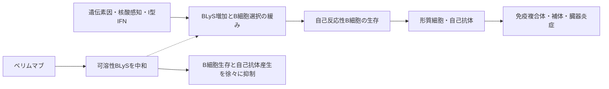

# ベリムマブ（Benlysta／ベンリスタ）

## まず3行で

- 自己抗体による炎症が皮膚、関節、腎臓などに及ぶ全身性エリテマトーデス（SLE）に、標準治療へ上乗せして用いる抗体である。
- 可溶性B細胞刺激因子BLyS（BAFF）を中和し、自己反応性B細胞が生き残るためのシグナルを弱める。
- B細胞を直接除去せず「生存因子への依存性」を狙い、SLE初の承認生物学的製剤を実用化した。

## 1. どんな病気か

SLEは免疫系が自己組織を攻撃する慢性疾患で、若い女性に多い。倦怠感、発熱、関節痛、皮疹から、血球減少、漿膜炎、神経症状まで現れ方は多彩で、増悪と寛解を繰り返す。免疫複合体が糸球体に沈着して起こるループス腎炎は、腎不全につながり得る重要な臓器病変である。[NIAMS](https://www.niams.nih.gov/health-topics/lupus)

病態の中心には、核酸などの自己抗原、I型インターフェロン、T細胞とB細胞の相互作用、自己抗体、補体が作る増幅回路がある。B細胞は自己抗体を作る形質細胞の前駆細胞であるだけでなく、抗原提示とサイトカイン産生にも関わる。遺伝的素因、ホルモン、感染・紫外線などの寄与は知られるが、患者ごとにどの経路が支配的か、増悪を何が始動するかは一様でない。従来のステロイドや免疫抑制薬は広く効く一方、臓器障害、再燃、感染・累積毒性が残るため、病的免疫をより選択的に調節する必要があった。

## 2. なぜこの分子を標的にするのか

BLyS（BAFF、TNFSF13B）はTNFファミリーのサイトカインで、主に単球、樹状細胞、好中球などから産生される。可溶性BLySはB細胞上のBAFF-R、TACI、BCMAに結合し、特に移行期から成熟B細胞の生存・選択を支える。BLyS過剰発現マウスでB細胞増加、自己抗体、糸球体腎炎が生じたことは、「生存シグナルが強すぎると、本来なら排除される自己反応性B細胞まで残る」という標的仮説を支えた。[Mackayら](https://pubmed.ncbi.nlm.nih.gov/10587360/)

長所は、細胞を一律に破壊せず、BLyS依存性の高い未熟・ナイーブB細胞や活性化B細胞を徐々に減らせることにある。対して、長寿命形質細胞はAPRIL―BCMAなど別の生存経路にも支えられ、既存自己抗体を直ちに消せない。BLyS値だけで効果を確実に予測できず、感染防御やワクチン応答に必要な正常B細胞も影響を受ける点が弱みである。

## 3. どんな抗体として設計されたか

### 開発企業

Human Genome Sciences（HGS）がゲノム探索からBLySを同定し、Cambridge Antibody TechnologyのヒトscFvファージディスプレイライブラリを共同で選別した。阻害活性を持つクローンを完全長抗体へ変換・最適化してHGS1006（ベリムマブ）を創製し、HGSが初期開発を主導した。GSKは2006年契約に基づき後期開発と商業化を共同で担い、2012年にHGSを買収した。[StohlとHilbert](https://pmc.ncbi.nlm.nih.gov/articles/PMC3264947/) [共同開発契約](https://www.sec.gov/Archives/edgar/data/901219/000095013309000480/w72865exv10w25.htm)

### 基本設計と作用の仕組み

約147 kDaの完全ヒトIgG1λ抗体で、可溶性ヒトBLySへ高親和性に結合し、三つの受容体への結合を妨げる。B細胞表面抗原を狙わないため、設計目的はADCCやCDCによる直接除去ではなく、BLySを捕捉して生存シグナルを下げることである。結果として自己反応性を含むB細胞の生存、形質細胞への分化、免疫グロブリン産生が緩やかに減る。[米国添付文書](https://www.accessdata.fda.gov/drugsatfda_docs/label/2026/125370s090lbl.pdf)

### 設計上の工夫

ファージディスプレイから完全ヒト配列を直接選び、標的発見から約12年で承認へつないだ点が中核である。特殊なFc改変や糖鎖改変ではなく、通常のIgG1骨格の半減期と製造性を利用した。日本では体重あたり10 mg/kgを初回、2週後、4週後、以後4週ごとに点滴静注できるほか、成人は200 mgを週1回皮下注射でき、訓練後の自己投与も可能である。5歳以上の小児には点滴静注と、体重別間隔のオートインジェクターが用意される。

## 4. 病態から作用まで

## 5. 何が画期的だったのか

ベリムマブは2011年、SLEに対する50年以上ぶりの米国新薬承認となり、B細胞生存因子を抑える戦略を臨床的に実証した。画期性は強い細胞傷害性ではなく、自己寛容の「選別閾値」をサイトカイン中和で戻そうとした点にある。標準治療への上乗せで複合疾患活動性と重症再燃を改善し、その後は活動性ループス腎炎でも腎反応を高め、標的治療の対象を重い臓器病変へ広げた。[Navarraら](https://pubmed.ncbi.nlm.nih.gov/21296403/) [Furieら](https://pubmed.ncbi.nlm.nih.gov/32937045/)

> **一言で評価：** この抗体の革新性は、B細胞を直接殺すのではなく、その生存を許すBLySという環境因子を抑え、SLEを機序から治療できると示したことにある。

## 6. 実際の医療での位置づけ

2026年10月13日時点、日本では抗核抗体や抗dsDNA抗体などが陽性で、ステロイド・免疫抑制薬等を使っても活動性が残るSLEに上乗せする。反応は緩徐で、6か月以内に得られなければ継続を再考する。日本の添付文書は重症ループス腎炎を別適応として明示していない一方、米国では5歳以上の活動性SLEと活動性ループス腎炎に承認されている。[PMDA点滴製剤](https://www.pmda.go.jp/PmdaSearch/iyakuDetail/ResultDataSetPDF/340278_3999445D1020_1_05) [PMDA皮下製剤](https://www.pmda.go.jp/PmdaSearch/iyakuDetail/ResultDataSetPDF/340278_3999445G1027_1_05)

重要な安全性は重篤な感染症、過敏症・輸注反応、まれなPMLで、生ワクチンは避ける。うつ病、自殺念慮・企図にも注意する。効果は全員に強く出るわけではなく、急速な臓器救済薬ではないが、皮膚・筋骨格症状や再燃を含む全身活動性を長期に抑え、ステロイド負担を減らす選択肢になる。

## 7. 類薬との違い

| 項目 | ベリムマブ | リツキシマブ | アニフロルマブ |
|---|---|---|---|
| 標的 | 可溶性BLyS/BAFF | B細胞表面CD20 | I型IFN受容体1 |
| 抗体形式 | 完全ヒトIgG1λ | キメラIgG1κ | 完全ヒトIgG1κ、Fc低活性化 |
| 作用の焦点 | B細胞の生存環境を弱める | CD20陽性B細胞を直接除去 | I型IFNシグナルを遮断 |
| 強み | SLE・腎炎で承認根拠、皮下注可 | 速く深いB細胞除去 | IFN駆動の多臓器炎症を上流で抑制 |
| 主な弱点 | 効果発現が緩徐、反応の個人差 | SLEでは適応外、輸注・感染リスク | 帯状疱疹など感染リスク |

最重要の違いは、ベリムマブがB細胞の数を強制的に落とすのではなく、自己反応性クローンが残りやすい「生存環境」を変えることである。アニフロルマブはB細胞より上流のIFN回路を狙い、患者ごとの優位経路というSLEの異質性を別角度から捉える。[PMDAサフネロー添付文書](https://www.pmda.go.jp/PmdaSearch/iyakuDetail/ResultDataSetPDF/670227_3999462A1028_1_04)

## 8. この抗体から学べること

- **疾患生物学：** 自己免疫は異常細胞だけでなく、その細胞を生かすサイトカイン環境でも成立する。
- **標的選択：** 遺伝子発見、動物モデル、患者のB細胞異常をつなぐことで、新規サイトカインを治療標的へ変えられる。
- **抗体設計：** 可溶性リガンド中和では、通常型IgGの持続性を使い、細胞傷害性を前面に出さない設計が合理的である。
- **残る課題：** 反応予測バイオマーカー、長寿命形質細胞、臓器別の最適な併用・治療順序が未解決である。
- **次に読む抗体：** CD20陽性B細胞を除去するリツキシマブ、I型IFN受容体を遮断するアニフロルマブ。

## 参考文献

1. ベンリスタ点滴静注用120 mg／400 mg 添付文書（2025年11月改訂）. 医薬品医療機器総合機構, 2025. [PMDA](https://www.pmda.go.jp/PmdaSearch/iyakuDetail/ResultDataSetPDF/340278_3999445D1020_1_05)（2026年10月13日アクセス）
2. ベンリスタ皮下注200 mgオートインジェクター／シリンジ 添付文書（2025年11月改訂）. 医薬品医療機器総合機構, 2025. [PMDA](https://www.pmda.go.jp/PmdaSearch/iyakuDetail/ResultDataSetPDF/340278_3999445G1027_1_05)（2026年10月13日アクセス）
3. BENLYSTA Prescribing Information（2026年8月改訂）. U.S. Food and Drug Administration, 2026. [FDA](https://www.accessdata.fda.gov/drugsatfda_docs/label/2026/125370s090lbl.pdf)（2026年10月13日アクセス）
4. Lupus Symptoms, Causes, & Risk Factors. National Institute of Arthritis and Musculoskeletal and Skin Diseases, 発行年記載なし. [NIAMS](https://www.niams.nih.gov/health-topics/lupus)（2026年10月13日アクセス）
5. Mackay F, et al. Mice transgenic for BAFF develop lymphocytic disorders along with autoimmune manifestations. *J Exp Med*. 1999;190:1697–1710. [PubMed](https://pubmed.ncbi.nlm.nih.gov/10587360/)
6. Stohl W, Hilbert DM. The discovery and development of belimumab: the anti-BLyS–lupus connection. *Nat Biotechnol*. 2012;30:69–77. [PMC](https://pmc.ncbi.nlm.nih.gov/articles/PMC3264947/)
7. Co-Development and Commercialization Agreement for belimumab. Human Genome Sciences / Glaxo Group, 2006. [SEC](https://www.sec.gov/Archives/edgar/data/901219/000095013309000480/w72865exv10w25.htm)（2026年10月13日アクセス）
8. Navarra SV, et al. Efficacy and safety of belimumab in patients with active systemic lupus erythematosus: a randomised, placebo-controlled, phase 3 trial. *Lancet*. 2011;377:721–731. [PubMed](https://pubmed.ncbi.nlm.nih.gov/21296403/)
9. Furie R, et al. Two-Year, Randomized, Controlled Trial of Belimumab in Lupus Nephritis. *N Engl J Med*. 2020;383:1117–1128. [PubMed](https://pubmed.ncbi.nlm.nih.gov/32937045/)
10. サフネロー点滴静注300 mg 添付文書（2026年2月改訂）. 医薬品医療機器総合機構, 2026. [PMDA](https://www.pmda.go.jp/PmdaSearch/iyakuDetail/ResultDataSetPDF/670227_3999462A1028_1_04)（2026年10月13日アクセス）
