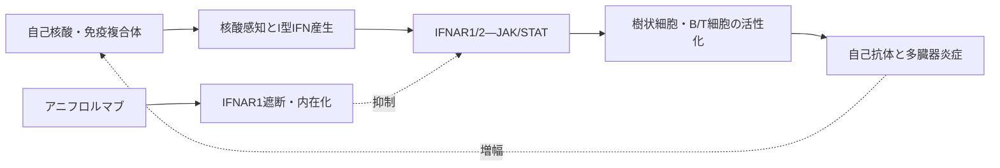

# アニフロルマブ（Saphnelo／サフネロー）

## まず3行で

- 自己抗体と免疫複合体による炎症が皮膚、関節、血球、腎臓などに及ぶ全身性エリテマトーデス（SLE）に、標準治療へ上乗せして用いる抗体である。
- I型インターフェロン（IFN）の共通受容体IFNAR1を塞いで内在化させ、核酸感知から広がる炎症性遺伝子発現を抑える。
- 多数あるI型IFNを個別に中和せず、共通受容体をFc非活性型抗体で狙う戦略をSLE治療として実用化した。

## 1. どんな病気か

SLEは免疫寛容が破綻し、抗核抗体などの自己抗体と免疫複合体が多臓器に炎症を起こす慢性自己免疫疾患で、若い女性に多い。倦怠感、発熱、関節痛、皮疹、血球減少から腎炎・神経障害まで症状は多彩で、増悪と寛解を繰り返す。[NIAMS](https://www.niams.nih.gov/health-topics/lupus)

細胞死で放出された核酸がTLR7/9などに感知されると、形質細胞様樹状細胞を中心にI型IFNが作られる。I型IFNは樹状細胞の成熟、B細胞の抗体産生、T細胞活性化を促し、さらに核酸と自己抗体を増やす正の循環を形成する。多くの患者の血液でIFN誘導遺伝子群が高発現するが、IFN優位でない患者もおり、個々の増悪を始動する経路は一様でない。ステロイドや免疫抑制薬は広く炎症を抑える一方、再燃、臓器障害、感染と累積毒性が残っていた。

## 2. なぜこの分子を標的にするのか

IFNAR1はIFNAR2と組んでほぼ全身の有核細胞に発現し、IFN-α、IFN-β、IFN-ωなどのI型IFNを受け取る。受容体が組み上がるとJAK1/TYK2―STAT経路が作動し、抗ウイルス蛋白や免疫調節分子を発現する。この防御反応がSLEでは慢性的に過剰となり、自然免疫と獲得免疫を同時に増幅する。

共通受容体を狙う長所は、多数のI型IFNをまとめて遮断できる点である。アニフロルマブはリガンド結合とIFNAR1/2複合体形成を妨げ、さらに表面IFNAR1を内在化させる。一方、IFNは正常な感染防御にも不可欠であり、呼吸器感染や帯状疱疹というオンターゲットの弱点がある。IFN遺伝子シグネチャー高値は病態を支えるが、承認上の必須選択検査ではなく、誰が最も利益を得るかは完全には予測できない。

## 3. どんな抗体として設計されたか

### 開発企業

MedImmuneがMEDI-546として創製・初期開発し、構造・薬理とFc非活性化設計を確立した。AstraZenecaは2007年にMedImmuneを買収し、後期臨床開発、承認取得、製造販売を進めた。[AstraZeneca沿革](https://www.astrazeneca.com/our-company/history.html)

### 基本設計と作用の仕組み

約148 kDaの完全ヒトIgG1κ抗体で、IFNAR1細胞外領域へ結合する。立体障害でI型IFNによる活性型受容体複合体の形成を阻み、受容体を速やかに内在化させるため、STAT1リン酸化、IFN誘導遺伝子発現、樹状細胞活性化や形質細胞への分化が抑えられる。[構造解析](https://pmc.ncbi.nlm.nih.gov/articles/PMC4622752/) [薬理解析](https://pmc.ncbi.nlm.nih.gov/articles/PMC5890856/)

### 設計上の工夫

FcにはL234F/L235E/P331S（FES）の3置換を導入し、Fcγ受容体結合と補体活性化を低下させた。狙いはIFNAR1陽性細胞をADCCやCDCで除去することではなく、広範な細胞にある受容体のシグナルだけを止めることにある。日本では300 mgを4週ごとに点滴静注するほか、2026年に120 mg週1回の皮下オートインジェクターが加わり、訓練後は自己投与できる。

## 4. 病態から作用まで

## 5. 何が画期的だったのか

アニフロルマブは、SLEで長く観察されてきた「IFN遺伝子シグネチャー」を、受容体遮断という治療へ結びつけた。個々のIFN-αサブタイプではなく共通受容体を狙い、内在化で表面受容体も減らしながら、Fcによる細胞傷害は抑えた点に病態と工学の整合性がある。ただし第III相TULIP-1は主要評価項目SRI-4を達成せず、TULIP-2では別の複合指標BICLAで改善を示した。二つの結果は、異質な多臓器疾患では治療効果の評価が複合指標の定義に左右され得ることも示した。[TULIP-1](https://pubmed.ncbi.nlm.nih.gov/38229377/) [TULIP-2](https://pubmed.ncbi.nlm.nih.gov/31851795/)

> **一言で評価：** この抗体の革新性は、多数のI型IFNが共有する受容体を「遮断・内在化し、細胞は殺さない」設計で、SLEの上流炎症回路を治療可能にしたことにある。

## 6. 実際の医療での位置づけ

2026年10月16日時点、日本では自己抗体陽性で、ステロイド、ヒドロキシクロロキン、免疫抑制薬などを使っても活動性が残る成人SLEへ上乗せする。皮膚・筋骨格を含む複数臓器の活動性と再燃を抑え、ステロイド減量を助ける選択肢である。活動性かつ重症のループス腎炎・中枢神経ループスは主要試験から除外され、適応判断には限界がある。[PMDA点滴製剤](https://www.pmda.go.jp/PmdaSearch/iyakuDetail/ResultDataSetPDF/670227_3999462A1028_1_04) [PMDA皮下製剤](https://www.pmda.go.jp/PmdaSearch/iyakuDetail/ResultDataSetPDF/670227_3999462G1020_1_01)

重要な安全性は重篤な感染症、特に呼吸器感染と帯状疱疹、過敏症・アナフィラキシーである。開始前に感染・結核・B型肝炎を評価し、治療中は生ワクチンを避ける。他の生物学的製剤との併用は有効性・安全性が確立していない。

## 7. 類薬との違い

| 項目 | アニフロルマブ | ベリムマブ | リツキシマブ |
|---|---|---|---|
| 標的 | IFNAR1 | 可溶性BLyS/BAFF | B細胞表面CD20 |
| 抗体形式 | 完全ヒトIgG1κ、FES Fc | 完全ヒトIgG1λ | キメラIgG1κ |
| 作用の焦点 | IFN回路を遮断・受容体内在化 | B細胞生存環境を弱める | CD20陽性B細胞を除去 |
| 強み | 上流の自然・獲得免疫を横断、皮下注可 | SLE・腎炎の承認根拠、皮下注可 | 速く深いB細胞除去 |
| 主な弱点 | 帯状疱疹、重症腎炎等の根拠不足 | 効果発現が緩徐 | SLEでは適応外、感染・輸注反応 |

最重要の違いは、アニフロルマブが特定の免疫細胞を減らすのではなく、その上流で多くの細胞を同時に駆動するIFN情報を遮断することである。広い回路を抑える利点は、抗ウイルス防御低下という弱点と表裏一体である。

## 8. この抗体から学べること

- **疾患生物学：** SLEは自己抗体だけでなく、核酸感知とI型IFNが作る自己増幅回路の病気でもある。
- **標的選択：** 多数のリガンドを一括して抑えるには、共有受容体が合理的な制御点になる。
- **抗体設計：** 広く発現する受容体では、遮断・内在化を生かし、Fc細胞傷害を切る設計が重要である。
- **残る課題：** 反応予測バイオマーカー、重症腎炎・中枢神経病変、最適な治療順序は未確立である。
- **次に読む抗体：** B細胞の生存因子を中和するベリムマブ、CD20陽性B細胞を除去するリツキシマブ。

## 参考文献

1. サフネロー点滴静注300 mg 添付文書（2026年2月改訂）. 医薬品医療機器総合機構, 2026. [PMDA](https://www.pmda.go.jp/PmdaSearch/iyakuDetail/ResultDataSetPDF/670227_3999462A1028_1_04)（2026年10月16日アクセス）
2. サフネロー皮下注120 mgオートインジェクター 添付文書（2026年8月改訂）. 医薬品医療機器総合機構, 2026. [PMDA](https://www.pmda.go.jp/PmdaSearch/iyakuDetail/ResultDataSetPDF/670227_3999462G1020_1_01)（2026年10月16日アクセス）
3. SAPHNELO Prescribing Information（2026年4月改訂）. U.S. Food and Drug Administration, 2026. [FDA](https://www.accessdata.fda.gov/drugsatfda_docs/label/2026/761123s012lbl.pdf)（2026年10月16日アクセス）
4. サフネロー点滴静注300 mg 審査報告書. 医薬品医療機器総合機構, 2021. [PMDA](https://www.pmda.go.jp/drugs/2021/P20211020001/670227000_30300AMX00447_A100_3.pdf)（2026年10月16日アクセス）
5. Lupus Symptoms, Causes, & Risk Factors. National Institute of Arthritis and Musculoskeletal and Skin Diseases, 発行年記載なし. [NIAMS](https://www.niams.nih.gov/health-topics/lupus)（2026年10月16日アクセス）
6. Oganesyan V, et al. Molecular basis for antagonistic activity of anifrolumab, an anti-interferon-α receptor 1 antibody. *mAbs*. 2015;7:555–566. [PMC](https://pmc.ncbi.nlm.nih.gov/articles/PMC4622752/)
7. Peng L, et al. Characterisation of anifrolumab, a fully human anti-interferon receptor antagonist antibody for the treatment of systemic lupus erythematosus. *Lupus Sci Med*. 2018;5:e000261. [PMC](https://pmc.ncbi.nlm.nih.gov/articles/PMC5890856/)
8. A timeline of our company history. AstraZeneca, 発行年記載なし. [AstraZeneca](https://www.astrazeneca.com/our-company/history.html)（2026年10月16日アクセス）
9. Furie RA, et al. Type I interferon inhibitor anifrolumab in active systemic lupus erythematosus (TULIP-1): a randomised, controlled, phase 3 trial. *Lancet Rheumatol*. 2019;1:e208–e219. [PubMed](https://pubmed.ncbi.nlm.nih.gov/38229377/)
10. Morand EF, et al. Trial of Anifrolumab in Active Systemic Lupus Erythematosus. *N Engl J Med*. 2020;382:211–221. [PubMed](https://pubmed.ncbi.nlm.nih.gov/31851795/)
