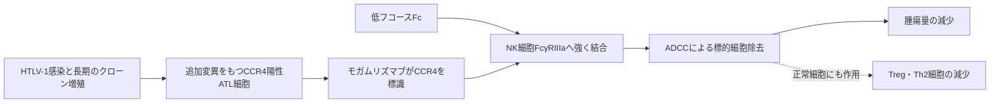

# モガムリズマブ（Poteligeo／ポテリジオ）

## まず3行で

- HTLV-1感染細胞から生じる成人T細胞白血病リンパ腫（ATL）を中心に、CCR4陽性T細胞リンパ腫へ用いる抗体である。
- 腫瘍細胞表面のCCR4を目印にし、NK細胞のFcγRIIIaを介する抗体依存性細胞傷害（ADCC）で標的細胞を除去する。
- Fc糖鎖からフコースを減らしてADCCを強める糖鎖工学を、承認薬として実用化した点が最も重要である。

## 1. どんな病気か

ATLは、ヒトT細胞白血病ウイルス1型（HTLV-1）が主にCD4陽性T細胞へ持続感染し、長い潜伏期間の後に一部の感染者で発症する成熟T細胞腫瘍である。急性型、リンパ腫型、慢性型、くすぶり型があり、進行例ではリンパ節腫脹、皮疹、末梢血異常細胞、高カルシウム血症、日和見感染などを来す。[NCI](https://www.cancer.gov/about-cancer/causes-prevention/risk/infectious-agents)

ウイルス蛋白TaxとHBZは感染クローンの増殖・生存や遺伝的不安定性を促し、長年の細胞分裂を通じてT細胞受容体、NF-κB、CCR4などの経路に追加異常が蓄積する。ただし、どの保因者が発症するか、各患者でどの異常が支配的かは一様でない。強力な多剤化学療法でも再発しやすく、同種造血幹細胞移植は長期寛解を得うる一方、年齢、全身状態、ドナー確保に制約があった。

## 2. なぜこの分子を標的にするのか

CCR4はCCL17とCCL22を受け取るG蛋白共役型ケモカイン受容体で、正常ではTh2細胞や制御性T細胞（Treg）の皮膚などへの移動を導く。ATL細胞では高頻度に発現し、CCR4陽性は皮膚浸潤と不良な転帰に関連する。HBZによる発現誘導や、一部のATLにあるCCR4細胞内末端の機能獲得型変異も、遊走・増殖を支えると考えられる。[CCR4臨床病理](https://pubmed.ncbi.nlm.nih.gov/14506150/)

細胞表面にあり、腫瘍クローンを正常細胞からある程度見分けられることが長所である。ただしCCR4は腫瘍の生存だけに必須な分子ではないため、モガムリズマブの主眼はシグナル阻害ではなくCCR4陽性細胞の物理的除去にある。発現の不均一性、NK細胞機能、CCR4陰性クローンは効果を制限しうる。また正常TregやTh2細胞も同時に減ることが、皮膚障害、感染、自己免疫反応、移植後合併症というオンターゲットの弱点になる。

## 3. どんな抗体として設計されたか

### 開発企業

協和発酵工業（現・協和キリン）がマウス抗CCR4抗体KM2160を基にヒト化抗体KW-0761を創製し、自社の糖鎖制御技術で低フコース化した。協和発酵キリンは日本で臨床開発し、2012年に再発・難治性CCR4陽性ATLで世界初承認を取得、後に日本・米国・欧州で適応を広げた。[PMDA初回審査](https://www.pmda.go.jp/files/000153052.pdf) [初回承認史](https://pubmed.ncbi.nlm.nih.gov/22686619/)

### 基本設計と作用の仕組み

CCR4のN末端細胞外領域を認識する約149 kDaのヒト化IgG1κ通常抗体で、点滴静注する。FabがCCR4陽性腫瘍細胞を標識し、Fcに結合したNK細胞などが細胞傷害顆粒を放出する。補体や受容体遮断よりADCCが中心であり、患者由来ATL細胞を用いた実験でも自己NK細胞依存的な傷害が確認された。[前臨床研究](https://pubmed.ncbi.nlm.nih.gov/20160057/)

### 設計上の工夫

IgG1 FcのN結合型糖鎖にあるコアフコースを減らすと、NK細胞のFcγRIIIaへの結合が強まり、低い抗原密度でもADCCが増強される。[低フコース化研究](https://pubmed.ncbi.nlm.nih.gov/15788684/) モガムリズマブでは、低フコース型を主成分とするよう生産細胞と品質規格を設計した。これは変異で標的への親和性を上げるのではなく、「抗体をつかむ免疫細胞側」の相互作用を糖鎖で最適化する発想である。半面、CCR4陽性Tregまで効率よく除くため、後の同種移植で免疫寛容が崩れる危険も強まる。

## 4. 病態から作用まで

## 5. 何が画期的だったのか

本剤は、腫瘍抗原を見つけるFabだけでなく、免疫細胞を動員するFc糖鎖を医薬品性能として設計できることを示した。低フコースIgG1はFcγRIIIa結合を高め、通常のIgG1では不十分になり得るADCCを増幅する。モガムリズマブはこのPOTELLIGENT型設計で最初に承認された抗体となり、その後の糖鎖改変抗体に臨床的な先例を与えた。[初回承認史](https://pubmed.ncbi.nlm.nih.gov/22686619/) 一方、Treg除去が抗腫瘍免疫を助ける可能性と、GVHDを悪化させる危険は同じ作用の両面であり、強いエフェクター機能には標的の正常発現まで含む設計評価が必要だと教える。

> **一言で評価：** この抗体の革新性は、CCR4を腫瘍細胞の「住所」として選び、低フコースFcでNK細胞の殺傷力を引き出す糖鎖工学を承認薬にしたことにある。

## 6. 実際の医療での位置づけ

2026年10月19日時点、日本ではCCR4陽性ATL、再発・難治性CCR4陽性末梢性T細胞リンパ腫、再発・難治性皮膚T細胞リンパ腫に承認されている。再発・難治性ATLとPTCLでは1 mg/kgを週1回、計8回、未治療ATLでは他の抗悪性腫瘍薬と併用し2週ごとに計8回投与する。ATL・PTCLでは治療前にフローサイトメトリーまたは免疫組織化学でCCR4陽性を確認する。[PMDA添付文書](https://www.pmda.go.jp/PmdaSearch/bookSearch/01/04987057586427) 再発ATLの第II相試験では単剤で半数に奏効したが、効果の持続は患者間で異なり、治癒的治療ではない。[第II相試験](https://pubmed.ncbi.nlm.nih.gov/22312108/)

重要な副作用は注入反応、重い薬疹・Stevens-Johnson症候群、感染、血球減少、腫瘍崩壊症候群である。特に移植候補では、長く残る抗体とTreg減少が重症・ステロイド抵抗性GVHDおよび非再発死亡の増加に関連したため、投与時期を移植計画と一体で判断する。[移植前投与研究](https://pubmed.ncbi.nlm.nih.gov/27507878/) 米国・EUでは、全身治療歴のある再発・難治性菌状息肉症またはセザリー症候群が中心適応である。[FDA](https://www.accessdata.fda.gov/drugsatfda_docs/label/2026/761051s025lbl.pdf)

## 7. 類薬との違い

| 項目 | モガムリズマブ | ブレンツキシマブ ベドチン | アレムツズマブ |
|---|---|---|---|
| 標的 | CCR4 | CD30 | CD52 |
| 抗体形式 | 低フコース化ヒト化IgG1κ | 抗CD30 ADC | ヒト化IgG1κ |
| 主作用 | 強化ADCCによる細胞除去 | MMAE送達による微小管阻害 | ADCC・CDCによる広いリンパ球除去 |
| 患者選択 | ATL・PTCLではCCR4陽性確認 | CD30発現が重要 | T細胞腫瘍では主に適応外使用 |
| 主な弱点 | Treg除去、皮膚障害、移植時GVHD | 末梢神経障害、CD30不均一性 | 深い免疫抑制、感染 |

最重要の違いは、モガムリズマブが薬物を運ぶのではなく、糖鎖改変Fcで宿主のNK細胞を効率よく使う点である。そのため効果は標的発現だけでなく、エフェクター細胞の量と機能にも左右される。

## 8. この抗体から学べること

- **疾患生物学：** ウイルス発がんは、持続感染、長期クローン増殖、宿主ゲノム異常の積み重ねとして理解できる。
- **標的選択：** 腫瘍の駆動因子でなくても、選択的な表面マーカーは細胞除去の標的になり得る。
- **抗体設計：** Fc糖鎖は飾りではなく、Fcγ受容体結合とADCCを変える制御部品である。
- **残る課題：** CCR4陰性化・不均一発現、NK細胞依存性、正常Treg除去と移植安全性の両立が残る。
- **次に読む抗体：** CD30陽性細胞へ毒素を運ぶブレンツキシマブ ベドチン、低フコース化でIL-5Rα陽性細胞を除去するベンラリズマブ。

## 参考文献

1. ポテリジオ点滴静注20 mg 添付文書（2026年1月改訂）. 医薬品医療機器総合機構, 2026. [PMDA](https://www.pmda.go.jp/PmdaSearch/bookSearch/01/04987057586427)（2026年10月19日アクセス）
2. Poteligeo Injection 20 mg Review Report. Pharmaceuticals and Medical Devices Agency, 2011. [PMDA](https://www.pmda.go.jp/files/000153052.pdf)（2026年10月19日アクセス）
3. POTELIGEO Prescribing Information（2026年2月改訂）. U.S. Food and Drug Administration, 2026. [FDA](https://www.accessdata.fda.gov/drugsatfda_docs/label/2026/761051s025lbl.pdf)（2026年10月19日アクセス）
4. Bangham CRM, et al. How does HTLV-1 cause adult T-cell leukaemia/lymphoma (ATL)? *Curr Opin Virol*. 2015;14:93–100. [PMC](https://pmc.ncbi.nlm.nih.gov/articles/PMC4772697/)
5. Ishida T, et al. Clinical significance of CCR4 expression in adult T-cell leukemia/lymphoma. *Clin Cancer Res*. 2003;9:3625–3634. [PubMed](https://pubmed.ncbi.nlm.nih.gov/14506150/)
6. Niwa R, et al. Enhanced natural killer cell binding and activation by low-fucose IgG1 antibody. *Clin Cancer Res*. 2005;11:2327–2336. [PubMed](https://pubmed.ncbi.nlm.nih.gov/15788684/)
7. Ishii T, et al. Defucosylated humanized anti-CCR4 monoclonal antibody KW-0761 as a novel immunotherapeutic agent for adult T-cell leukemia/lymphoma. *Clin Cancer Res*. 2010;16:1520–1531. [PubMed](https://pubmed.ncbi.nlm.nih.gov/20160057/)
8. Ishida T, et al. Defucosylated anti-CCR4 monoclonal antibody (KW-0761) for relapsed adult T-cell leukemia-lymphoma: a multicenter phase II study. *J Clin Oncol*. 2012;30:837–842. [PubMed](https://pubmed.ncbi.nlm.nih.gov/22312108/)
9. Subramaniam JM, et al. Mogamulizumab: first global approval. *Drugs*. 2012;72:1293–1298. [PubMed](https://pubmed.ncbi.nlm.nih.gov/22686619/)
10. Fuji S, et al. Pretransplantation anti-CCR4 antibody mogamulizumab against adult T-cell leukemia/lymphoma is associated with increased risks of severe graft-versus-host disease. *J Clin Oncol*. 2016;34:3426–3433. [PubMed](https://pubmed.ncbi.nlm.nih.gov/27507878/)
