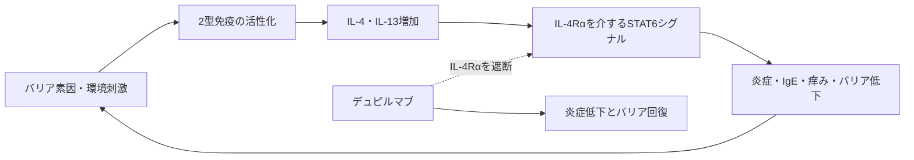

# デュピルマブ（Dupixent／デュピクセント）

## まず3行で

- 外用治療で十分に制御できないアトピー性皮膚炎をはじめ、2型炎症が関わる皮膚・気道疾患に用いる抗体である。
- IL-4とIL-13の受容体が共有するIL-4Rαに結合し、2本のサイトカイン経路を同時に遮断する。
- 広い免疫抑制や細胞除去ではなく、臓器をまたぐ炎症の共通回路を選択的に抑える治療概念を実証した点が重要である。

## 1. どんな病気か

アトピー性皮膚炎は、乾燥した炎症性皮疹と強い痒みが増悪・寛解を繰り返す慢性疾患で、乳幼児期に始まることが多い。掻破は皮膚をさらに傷つけ、睡眠障害や細菌・ウイルス感染も招く。[NIAMS](https://www.niams.nih.gov/health-topics/atopic-dermatitis)

病態は「皮膚バリアの弱さ」と「免疫の過剰反応」の一方向ではない循環として理解するとよい。フィラグリンなどの遺伝的・後天的低下で水分と外来物質の遮断が弱まり、上皮由来シグナルがTh2細胞や2型自然リンパ球を活性化する。そこで産生されるIL-4、IL-13、IL-31などが炎症と痒みを強め、IL-4/IL-13はケラチノサイトのフィラグリン発現も下げるため、バリア障害が再び悪化する。[皮膚バリア研究](https://pubmed.ncbi.nlm.nih.gov/17512043/) ただし、遺伝子、微生物叢、神経免疫、他のサイトカインの寄与は患者ごとに異なり、IL-4/IL-13だけで全病態は説明できない。

従来の保湿・外用抗炎症薬は今も基盤だが、広範な中等症以上では不十分なことがあり、従来型の全身免疫抑制薬には臓器毒性や感染、長期使用の制約があった。

## 2. なぜこの分子を標的にするのか

IL-4Rαは2種類の受容体複合体の共通部品である。IL-4Rαと共通γ鎖からなるI型受容体は主に造血細胞でIL-4を受け取り、IL-4RαとIL-13Rα1からなるII型受容体は上皮細胞などにも広く、IL-4とIL-13の両方を受け取る。シグナルはJAK–STAT6系を介して、Th2分化、B細胞のIgEクラススイッチ、粘液産生、好酸球遊走、皮膚バリア遺伝子の抑制などを促す。

したがって共通鎖IL-4Rαを一つ塞げば、リガンドを2種類別々に中和せず、炎症の誘導側に強いIL-4と組織反応側に強いIL-13を同時に抑えられる。細胞外受容体を抗体で選択的・持続的に覆う設計は、複数の細胞内キナーゼを阻害する低分子薬より作用範囲を限定しやすい。一方、2型免疫は寄生虫防御や組織修復にも関わるため、寄生虫感染には注意が必要である。

## 3. どんな抗体として設計されたか

### 開発企業

RegeneronがVelocImmune技術を用いて完全ヒト抗体を創製し、2007年に始まった提携下でSanofiと臨床開発・商業化を進めた。[創製・作用機序研究](https://pubmed.ncbi.nlm.nih.gov/31838750/) [提携資料](https://www.sec.gov/Archives/edgar/data/872589/000095012307016134/y43351exv99w1.htm) 2017年に米国で中等症から重症の成人アトピー性皮膚炎に初承認された。

### 基本設計と作用の仕組み

約152 kDaの完全ヒトIgG4κ通常抗体で、IL-4Rαの細胞外領域へ高親和性に結合し、IL-4/IL-13によるSTAT6活性化を阻害する。IgG4は細胞傷害性が低く、審査資料でもADCC・CDCは検出されなかったため、IL-4Rα陽性細胞を除去せずシグナルだけを止める。[PMDA初回審査](https://www.pmda.go.jp/drugs/2018/P20180129001/780069000_23000AMX00015_A100_1.pdf)

### 設計上の工夫

IgG4で起こり得るFab-arm exchangeを抑えるため、ヒンジを安定化するPro置換（規制文書の配列番号でH鎖233位）を持つ。皮下投与用のシリンジ・ペン製剤とし、成人アトピー性皮膚炎では初回600 mg後、300 mgを2週ごとに投与する。これは標的細胞を殺す抗体ではなく、慢性疾患で長く受容体を占有する「静かな遮断抗体」という設計である。

## 4. 病態から作用まで

## 5. 何が画期的だったのか

デュピルマブは、アトピー性皮膚炎を単なる皮膚症状ではなく、標的化できる2型炎症疾患として臨床的に示した。第III相試験では単剤でも皮疹と痒みを明確に改善し、治療後の皮膚では2型炎症遺伝子の低下とバリア・脂質代謝遺伝子の回復が観察された。[第III相試験](https://pubmed.ncbi.nlm.nih.gov/27690741/) [皮膚分子応答](https://pubmed.ncbi.nlm.nih.gov/30194992/) 同じ共通回路を狙うことで喘息、鼻茸、結節性痒疹などへ展開できたことも、臓器別分類を越える標的選択の価値を示す。

> **一言で評価：** この抗体の革新性は、IL-4Rαという共有受容体を選び、IL-4とIL-13が作る多臓器の2型炎症を一つの低エフェクターIgG4で制御したことにある。

## 6. 実際の医療での位置づけ

2026年10月22日時点、日本では既存治療で効果不十分なアトピー性皮膚炎（生後6カ月以上）、結節性痒疹、特発性慢性蕁麻疹、中等症から重症の水疱性類天疱瘡、重症・難治性喘息、2型炎症を伴うCOPD、鼻茸を伴う慢性副鼻腔炎に用いられる。疾患・年齢・体重で投与量は異なり、アトピー性皮膚炎では保湿・抗炎症外用を継続する。[PMDA添付文書](https://www.pmda.go.jp/PmdaSearch/rdDetail/iyaku/4490405G1024_1)

全身性免疫抑制薬に比べ標的が絞られ、自己注射できる点が強みである。主な注意点は注射部位反応、結膜炎・角膜炎、過敏症、好酸球増加で、喘息では急性発作を止める薬ではない。眼症状がなぜアトピー性皮膚炎で目立つか、治療開始後の一過性好酸球増加が誰で臓器障害へ進むかは完全には解明されていない。

## 7. 類薬との違い

| 項目 | デュピルマブ | トラロキヌマブ | ネモリズマブ |
|---|---|---|---|
| 標的 | IL-4Rα | IL-13 | IL-31Rα |
| 抗体形式 | 完全ヒトIgG4κ | ヒトIgG4 | ヒト化IgG2κ |
| 主作用 | IL-4/IL-13を二重遮断 | IL-13を選択的に中和 | 痒みの神経免疫経路を遮断 |
| 強み | 多臓器の2型炎症を広く制御 | IL-4機能を残す | 痒みに直結する経路を狙う |
| 弱点 | 眼症状、好酸球増加 | 適応・作用範囲が狭い | 炎症・バリアへの直接作用は狙わない |

最も重要な違いは標的範囲である。デュピルマブは共通受容体を選ぶことで広い有用性を得た一方、IL-13単独阻害やIL-31Rα阻害は病態の特定部分をより選択的に切り分ける。

## 8. この抗体から学べること

- **疾患生物学：** 皮膚バリア障害と2型炎症は互いを増幅する。
- **標的選択：** 共有受容体サブユニットは複数リガンドと複数臓器を一度に制御できる。
- **抗体設計：** IgG4とヒンジ安定化は、受容体陽性細胞を殺さず慢性シグナルを遮断する目的に合う。
- **残る課題：** 非2型炎症の患者選別、眼障害・好酸球増加の機序、長期投与の最適化が残る。
- **次に読む抗体：** IL-13だけを中和するトラロキヌマブ、IL-31Rαを遮断して痒みを狙うネモリズマブ。

## 参考文献

1. デュピクセント皮下注 添付文書（2026年3月改訂）. 医薬品医療機器総合機構, 2026. [PMDA](https://www.pmda.go.jp/PmdaSearch/rdDetail/iyaku/4490405G1024_1)（2026年10月22日アクセス）
2. デュピクセント皮下注300 mgシリンジ 審査報告書. 医薬品医療機器総合機構, 2017. [PMDA](https://www.pmda.go.jp/drugs/2018/P20180129001/780069000_23000AMX00015_A100_1.pdf)（2026年10月22日アクセス）
3. DUPIXENT Prescribing Information（2026年4月改訂）. U.S. National Library of Medicine / FDA, 2026. [DailyMed](https://dailymed.nlm.nih.gov/dailymed/drugInfo.cfm?setid=595f437d-2729-40bb-9c62-c8ece1f82780)（2026年10月22日アクセス）
4. Atopic Dermatitis. National Institute of Arthritis and Musculoskeletal and Skin Diseases, 2022. [NIAMS](https://www.niams.nih.gov/health-topics/atopic-dermatitis)（2026年10月22日アクセス）
5. Howell MD, et al. Cytokine modulation of atopic dermatitis filaggrin skin expression. *J Allergy Clin Immunol*. 2007;120:150–155. [PubMed](https://pubmed.ncbi.nlm.nih.gov/17512043/)
6. Le Floc'h A, et al. Dual blockade of IL-4 and IL-13 with dupilumab, an IL-4Rα antibody, is required to broadly inhibit type 2 inflammation. *Allergy*. 2020;75:1188–1204. [PubMed](https://pubmed.ncbi.nlm.nih.gov/31838750/)
7. Simpson EL, et al. Two Phase 3 Trials of Dupilumab versus Placebo in Atopic Dermatitis. *N Engl J Med*. 2016;375:2335–2348. [PubMed](https://pubmed.ncbi.nlm.nih.gov/27690741/)
8. Guttman-Yassky E, et al. Dupilumab progressively improves systemic and cutaneous abnormalities in patients with atopic dermatitis. *J Allergy Clin Immunol*. 2019;143:155–172. [PubMed](https://pubmed.ncbi.nlm.nih.gov/30194992/)
9. Regeneron Initiates Major Global Collaboration with Sanofi-aventis. Regeneron Pharmaceuticals / SEC, 2007. [SEC](https://www.sec.gov/Archives/edgar/data/872589/000095012307016134/y43351exv99w1.htm)（2026年10月22日アクセス）
10. アドトラーザ皮下注 添付文書. 医薬品医療機器総合機構, 2024. [PMDA](https://www.pmda.go.jp/PmdaSearch/rdDetail/iyaku/4490409G2029_1?user=1)（2026年10月22日アクセス）
