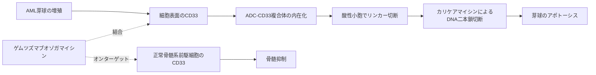

# ゲムツズマブオゾガマイシン（Mylotarg／マイロターグ）

## まず3行で

- CD33陽性の急性骨髄性白血病（AML）に用いる、抗体と強力なDNA傷害薬を一体化したADCである。
- CD33を目印に白血病細胞へ取り込まれ、酸性の細胞内小胞でカリケアマイシンを放出してDNA二本鎖切断を起こす。
- 米国初の抗がんADCであり、市場撤退と再承認を通じて「標的・分子設計だけでなく投与設計も治療域を決める」と示した点が重要である。

## 1. どんな病気か

AMLは、遺伝子異常を重ねた骨髄系前駆細胞が分化を止めて増殖する血液がんである。芽球が骨髄を占拠すると正常な血球を作れず、貧血、感染、出血が急速に現れる。[NCI](https://www.cancer.gov/types/leukemia/hp/adult-aml-treatment-pdq)

AMLは遺伝学的に不均一で、多剤化学療法と造血幹細胞移植で治癒を狙える一方、高齢者や再発例では毒性と耐性が壁になる。同一患者内でもCD33量が異なり、低発現クローンが再発し得るが、耐性を単一指標では予測できない。

## 2. なぜこの分子を標的にするのか

CD33（Siglec-3）は骨髄系前駆細胞、単球などに発現する抑制性受容体である。AML芽球の多くにあり、抗体結合後に内在化するため毒素を運ぶ「住所」に適する。[初期設計研究](https://pubmed.ncbi.nlm.nih.gov/11792178/) 未分化な造血幹細胞では概して乏しく、造血回復を期待できる点も利点である。ただし生理機能には未解明な部分が残る。

ただしCD33は白血病の必須ドライバーではなく、正常骨髄系細胞にもあるため骨髄抑制は避けにくい。低発現芽球には十分な薬物を届けにくく、小児AMLではCD33低発現群に上乗せ効果がみられなかった。[CD33発現解析](https://pubmed.ncbi.nlm.nih.gov/26786921/)

## 3. どんな抗体として設計されたか

### 開発企業

CelltechとWyeth-Ayerst Researchが共同開発・上市した。現在はWyethを取得したPfizerが製造、開発、販売を担う。[開発史](https://pubmed.ncbi.nlm.nih.gov/11249747/)

### 基本設計と作用の仕組み

約153 kDaのヒト化IgG4κ抗体hP67.6に、酸解離性AcButリンカーでカリケアマイシン誘導体を結合したADCである。IgG4ヒンジをS228P変異で安定化し、Fc細胞傷害より薬物送達を主目的とする。CD33結合後に内在化し、酸性小胞でリンカーが切れる。活性化した薬物がDNA二本鎖を切断し、アポトーシスを起こす。[米国添付文書](https://dailymed.nlm.nih.gov/dailymed/lookup.cfm?setid=32fd2bb2-1cfa-4250-feb8-d7956c794e05)

### 設計上の工夫

遊離では治療域が狭い薬物を抗体で運び、酸性環境で放す設計である。薬物結合抗体には平均4～6個の薬物が付く一方、製剤中の約半数は非結合抗体で不均一であり、CD33を競合し得る。静脈内投与で、日本では9 mg/m²を14日以上空けて2回、米国では3 mg/m²の分割投与を中心に用いる。

## 4. 病態から作用まで

## 5. 何が画期的だったのか

2000年に米国初の抗がんADCとして承認されたが、高用量投与での早期死亡が問題となり、2010年に自主撤退した。その後、低用量を1、4、7日に分けてピーク曝露を抑え、有効性を示して2017年に再承認された。[ALFA-0701](https://pubmed.ncbi.nlm.nih.gov/22482940/) 分子を変えず投与法でベネフィット・リスクを再設計した経緯は、ADC開発の重要な教訓である。

> **一言で評価：** この抗体の革新性は、CD33を入口に超高活性DNA傷害薬を細胞内送達し、さらに分割投与によって初期ADCの狭い治療域を臨床的に立て直したことにある。

## 6. 実際の医療での位置づけ

2026年10月25日時点、日本では他の再寛解導入療法が適さない成人の再発・難治性CD33陽性AMLに単剤で用いる。[PMDA添付文書](https://www.pmda.go.jp/PmdaSearch/iyakuDetail/672212_4239400D1030_3_02) 米国では新規診断例を含む成人・小児に承認される。効果は一様でなく、CD33量や細胞遺伝学的リスクを含む患者選択が重要である。

重要な毒性は骨髄抑制、感染・出血、infusion reaction、肝静脈閉塞性疾患（VOD/SOS）で、特に移植前後は肝障害に注意する。CD33低下、薬物排出、DNA損傷応答など複数の耐性機序が示唆されるが、患者ごとの支配因子は未解明である。

## 7. 類薬との違い

| 項目 | ゲムツズマブオゾガマイシン | イノツズマブ オゾガマイシン | ブレンツキシマブ ベドチン |
|---|---|---|---|
| 標的 | CD33 | CD22 | CD30 |
| 主な疾患 | AML | B細胞性ALL | CD30陽性リンパ腫 |
| 抗体・薬物 | ヒト化IgG4・カリケアマイシン | ヒト化IgG4・カリケアマイシン | キメラIgG1・MMAE |
| 放出設計 | 酸解離性AcButリンカー | 同系統のAcButリンカー | プロテアーゼ切断性vcリンカー |
| 主な弱点 | 骨髄抑制、VOD、抗原不均一性 | VOD、骨髄抑制 | 末梢神経障害、好中球減少 |

重要なのは、同じ薬物でも入口となる血球抗原で疾患と毒性が変わり、リンカー・薬物が違えば細胞内放出と耐性も変わる点である。

## 8. この抗体から学べること

- **疾患生物学：** AMLはCD33発現量も幹細胞性も不均一なクローン集団である。
- **標的選択：** がんの必須ドライバーでなくても、広く発現して内在化する抗原は薬物送達の住所になる。
- **抗体設計：** 抗体、リンカー、ペイロード、結合の均一性、投与スケジュールを一体として設計する必要がある。
- **残る課題：** VODと正常造血毒性を抑え、CD33低発現・薬物排出による耐性を予測すること。
- **次に読む抗体：** 同じ薬物・リンカーをCD22へ展開したイノツズマブ オゾガマイシン、異なるADC設計のブレンツキシマブ ベドチン。

## 参考文献

1. マイロターグ点滴静注用5 mg 添付文書（2022年3月改訂）. 医薬品医療機器総合機構, 2022. [PMDA](https://www.pmda.go.jp/PmdaSearch/iyakuDetail/672212_4239400D1030_3_02)（2026年10月25日アクセス）
2. マイロターグ注射用5 mg 審査報告書. 医薬品医療機器総合機構, 2005. [PMDA](https://www.pmda.go.jp/drugs/2005/P200500021/53039600_21700AMY00219_Q100_3.pdf)（2026年10月25日アクセス）
3. MYLOTARG Prescribing Information（2025年12月更新）. U.S. National Library of Medicine / FDA, 2025. [DailyMed](https://dailymed.nlm.nih.gov/dailymed/lookup.cfm?setid=32fd2bb2-1cfa-4250-feb8-d7956c794e05)（2026年10月25日アクセス）
4. Acute Myeloid Leukemia Treatment (PDQ®)–Health Professional Version. National Cancer Institute. [NCI](https://www.cancer.gov/types/leukemia/hp/adult-aml-treatment-pdq)（2026年10月25日アクセス）
5. Hamann PR, et al. Gemtuzumab ozogamicin, a potent and selective anti-CD33 antibody-calicheamicin conjugate for treatment of acute myeloid leukemia. *Bioconjug Chem*. 2002;13:47–58. [PubMed](https://pubmed.ncbi.nlm.nih.gov/11792178/)
6. Walter RB, et al. Influence of CD33 expression levels and ITIM-dependent internalization on gemtuzumab ozogamicin-induced cytotoxicity. *Blood*. 2005;105:1295–1302. [PubMed](https://pubmed.ncbi.nlm.nih.gov/15454492/)
7. Castaigne S, et al. Effect of gemtuzumab ozogamicin on survival of adult patients with de-novo acute myeloid leukaemia (ALFA-0701). *Lancet*. 2012;379:1508–1516. [PubMed](https://pubmed.ncbi.nlm.nih.gov/22482940/)
8. Pollard JA, et al. CD33 Expression and Its Association With Gemtuzumab Ozogamicin Response. *J Clin Oncol*. 2016;34:747–755. [PubMed](https://pubmed.ncbi.nlm.nih.gov/26786921/)
9. BLA 761060 Mylotarg: FDA Oncologic Drugs Advisory Committee briefing. U.S. Food and Drug Administration, 2017. [FDA](https://www.fda.gov/media/106459/download)（2026年10月25日アクセス）
10. Niculescu-Duvaz I. Technology evaluation: gemtuzumab ozogamicin, Celltech Group. *Curr Opin Mol Ther*. 2000;2:691–696. [PubMed](https://pubmed.ncbi.nlm.nih.gov/11249747/)
