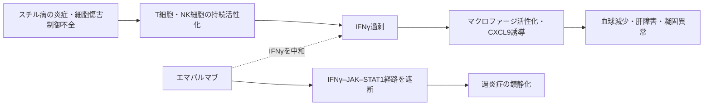

# エマパルマブ（Gamifant／ガミファント）

## まず3行で

- スチル病に伴うマクロファージ活性化症候群（MAS）と、米国では難治性の一次性血球貪食性リンパ組織球症（pHLH）に用いる抗体である。
- 過剰なインターフェロンγ（IFNγ）を捕捉し、受容体を介するJAK–STAT1シグナルとマクロファージ活性化を抑える。
- 致死的な「サイトカインの暴走」を広く抑えるのではなく、病態指標CXCL9で追跡できるIFNγ経路へ絞った初の承認抗体である。

## 1. どんな病気か

全身型若年性特発性関節炎（sJIA）と成人発症スチル病（AOSD）は、発熱、発疹、関節炎を来す全身性炎症疾患である。その重篤な合併症がMASで、T細胞とマクロファージが過剰に活性化し、高熱、肝脾腫、血球減少、凝固異常、肝障害、高フェリチン血症から多臓器不全へ急速に進み得る。[PMDA審査報告書](https://www.pmda.go.jp/drugs/2026/P20260930003/371336000_30800AMX00331_A100_1.pdf)

通常、細胞傷害性T細胞やNK細胞は感染細胞を排除して免疫反応を終息させる。pHLHでは`PRF1`などの異常でこの終結が壊れ、MASではIL-18などの炎症入力がT細胞を駆動する。両者はIFNγ過剰という共通点を持つが、MASにはIL-1やIL-6も関わり、全例をIFNγだけでは説明できない。

## 2. なぜこの分子を標的にするのか

IFNγは主に活性化T細胞とNK細胞が作るサイトカインで、正常時はマクロファージを活性化し、抗原提示を高めて細胞内病原体への防御を担う。MASではIFNγと、その下流で誘導されるCXCL9が上昇し、CXCL9量は血球減少や肝障害などの重症度と相関した。[Gromら](https://pubmed.ncbi.nlm.nih.gov/27296321/) 動物モデルでもIFNγ中和によりHLH様病態が改善し、治療標的としての因果性が支持された。[Jordanら](https://pubmed.ncbi.nlm.nih.gov/15069016/)

上流のT細胞を除去せずIFNγを中和できるのが長所である。一方、IFNγは結核菌、ヘルペスウイルス、真菌への防御に重要なため、阻害は感染症というオンターゲット毒性を伴う。CXCL9低下は経路遮断を示すが、寛解を保証しない。

## 3. どんな抗体として設計されたか

### 開発企業

NovimmuneがNI-0501として創製し、pHLHで臨床開発した。Sobiは2019年に知的財産、データ、開発人員を含む関連資産を取得し、以後の開発・販売を担う。[Sobi](https://www.sobi.com/en/press-releases/sobi-completes-acquisition-emapalumab-and-related-assets-1708794)

### 基本設計と作用の仕組み

CHO細胞で作る約148 kDaの完全ヒトIgG1λ抗体で、遊離IFNγとIFNγ受容体1に結合済みのIFNγを非競合的に中和する。STAT1活性化を止める一方、in vitroでADCC・CDCは検出されず、リガンド中和に機能を絞る。[FDA審査資料](https://www.accessdata.fda.gov/drugsatfda_docs/nda/2018/761107Orig1s000MultidisciplineR.pdf)

### 設計上の工夫

Fcや糖鎖の特殊改変ではなく、病勢に応じた曝露設計が特徴である。IFNγが多いほど抗体との複合体が速く消失する標的介在性クリアランスを示し、HLH患者の半減期は約2.5～18.9日と変動する。このため日本では6 mg/kgで迅速に負荷し、3 mg/kgを3日ごとに5回、その後週2回点滴し、反応に応じて調節する。[米国添付文書](https://www.accessdata.fda.gov/drugsatfda_docs/label/2026/761107s022lbl.pdf)

## 4. 病態から作用まで

## 5. 何が画期的だったのか

2018年に米国でpHLH初の標的治療として承認され、2025年にはスチル病に伴うHLH/MASへ拡大した。日本でも2026年9月、ステロイド等で効果不十分なsJIA・AOSD関連MASに承認された。「IFNγ優位の過炎症」を標的にし、CXCL9で薬力学を確かめて曝露を調節する点が重要である。ただし試験は単群で、欧州ではpHLH申請が2020年にデータ不足を理由に拒否されており、確実性を誇張すべきではない。[EMA](https://www.ema.europa.eu/en/medicines/human/EPAR/gamifant)

> **一言で評価：** この抗体の革新性は、致死的な高サイトカイン状態からIFNγ依存成分を切り出し、測定可能な薬力学指標と可変用量を組み合わせた標的治療に変えたことにある。

## 6. 実際の医療での位置づけ

2026年10月28日時点、日本ではsJIAまたはAOSDに伴うMASで、副腎皮質ステロイド等の適切な治療でも効果不十分な患者に用いる。[PMDA電子添文](https://www.pmda.go.jp/PmdaSearch/iyakuDetail/ResultDataSetPDF/371336_39994G0A1022_1_01) 米国では難治・再発・進行性pHLHにも承認され、造血幹細胞移植までの病勢制御に使われる。

最重要リスクは感染症で、潜在性結核の評価、帯状疱疹、EBV、CMVなどの監視と必要時の予防投与が求められ、生ワクチンは避ける。日本のMAS試験は39例と小さく、AOSD、低月齢児、再投与のデータは全例調査で補う必要がある。

## 7. 類薬との違い

| 項目 | エマパルマブ | カナキヌマブ | トシリズマブ |
|---|---|---|---|
| 標的 | IFNγ | IL-1β | IL-6受容体 |
| 主な狙い | 発症後MASの過炎症 | スチル病本体の炎症 | スチル病本体の炎症 |
| 抗体形式 | 完全ヒトIgG1λ | 完全ヒトIgG1κ | ヒト化IgG1κ |
| 日本でのMAS適応 | あり | なし | なし |
| 主な弱点 | 細胞内病原体・ウイルス防御低下 | IL-1以外の経路が残る | CRP・発熱をマスクし得る |

重要なのは、スチル病の慢性炎症を制御するIL-1/IL-6阻害と、成立したMASのIFNγ優位な増幅回路を止める治療は同じではない点である。

## 8. この抗体から学べること

- **疾患生物学：** 異なる起点のHLH/MASが、IFNγ過剰という共通の実行経路へ収束し得る。
- **標的選択：** 疾患全体ではなく、重症化を駆動し測定可能なサイトカイン軸を選ぶ方法がある。
- **抗体設計：** 標的量がクリアランスを変える抗体では、負荷投与、短い間隔、反応別調節までが設計になる。
- **残る課題：** IFNγ非依存性MASの識別、感染リスク低減、希少疾患での比較データ蓄積。
- **次に読む抗体：** スチル病本体のIL-6経路を遮断するトシリズマブ、補体性過炎症を止めるエクリズマブ。

## 参考文献

1. ガミファント点滴静注液50 mg 電子添文（2026年9月作成）. 医薬品医療機器総合機構, 2026. [PMDA](https://www.pmda.go.jp/PmdaSearch/iyakuDetail/ResultDataSetPDF/371336_39994G0A1022_1_01)（2026年10月28日アクセス）
2. ガミファント点滴静注液50 mg 審査報告書. 医薬品医療機器総合機構, 2026. [PMDA](https://www.pmda.go.jp/drugs/2026/P20260930003/371336000_30800AMX00331_A100_1.pdf)（2026年10月28日アクセス）
3. GAMIFANT Prescribing Information（2026年3月改訂）. U.S. Food and Drug Administration, 2026. [FDA](https://www.accessdata.fda.gov/drugsatfda_docs/label/2026/761107s022lbl.pdf)（2026年10月28日アクセス）
4. BLA 761107 Multi-Disciplinary Review and Evaluation. U.S. Food and Drug Administration, 2018. [FDA](https://www.accessdata.fda.gov/drugsatfda_docs/nda/2018/761107Orig1s000MultidisciplineR.pdf)（2026年10月28日アクセス）
5. Grom AA, et al. Elevated circulating levels of interferon-γ and interferon-γ-induced chemokines characterise patients with MAS complicating sJIA. *Ann Rheum Dis*. 2016;75:2097–2103. [PubMed](https://pubmed.ncbi.nlm.nih.gov/27296321/)
6. De Benedetti F, et al. Efficacy and safety of emapalumab in macrophage activation syndrome. *Ann Rheum Dis*. 2023;82:857–865. [PubMed](https://pubmed.ncbi.nlm.nih.gov/37001971/)
7. Locatelli F, et al. Emapalumab in Children with Primary Hemophagocytic Lymphohistiocytosis. *N Engl J Med*. 2020;382:1811–1822. [PubMed](https://pubmed.ncbi.nlm.nih.gov/32374962/)
8. Jordan MB, et al. An animal model of HLH: CD8+ T cells and interferon gamma are essential for the disorder. *Blood*. 2004;104:735–743. [PubMed](https://pubmed.ncbi.nlm.nih.gov/15069016/)
9. Sobi completes acquisition of emapalumab and related assets. Swedish Orphan Biovitrum, 2019. [Sobi](https://www.sobi.com/en/press-releases/sobi-completes-acquisition-emapalumab-and-related-assets-1708794)（2026年10月28日アクセス）
10. Gamifant: EPAR—refusal public assessment report. European Medicines Agency, 2021. [EMA](https://www.ema.europa.eu/en/medicines/human/EPAR/gamifant)（2026年10月28日アクセス）
