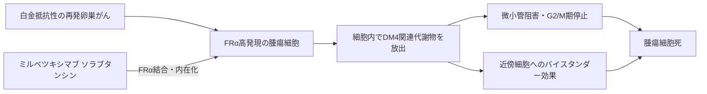

# ミルベツキシマブ ソラブタンシン（Elahere／エラヒア）

## まず3行で

- 葉酸受容体α（FRα）陽性で、白金製剤が効きにくくなった再発卵巣がんに用いる抗体薬物複合体（ADC）である。
- FRαを「がん細胞への住所」として内在化し、切断型リンカーから微小管阻害薬DM4を細胞内へ放出する。
- 卵巣がんで初めて実用化されたADCであり、抗原量を測って患者を選ぶこと、腫瘍内の不均一性をバイスタンダー効果で補うことを一つの治療設計にした。

## 1. どんな病気か

上皮性卵巣がん、卵管がん、原発性腹膜がんは共通するミュラー管上皮由来の病態として扱われ、多くは腹膜播種後に見つかる。中心となる高異型度漿液性がんでは`TP53`異常がほぼ普遍的で、約半数に相同組換え修復異常がある。手術と白金製剤を含む化学療法が基本だが、再発を重ね、最終的に白金治療終了後6カ月以内に進行する「白金抵抗性」へ移る患者が多い。[NCI PDQ](https://www.cancer.gov/types/ovarian/hp/ovarian-epithelial-treatment-pdq)

この段階では単剤化学療法の効果は限られ、耐性はDNA修復、薬剤排出、クローン選択など複数要因からなる。そこで、耐性機序そのものを一つずつ阻害するのではなく、腫瘍表面抗原を目印に別の強力な毒性を届ける発想が意味を持つ。

## 2. なぜこの分子を標的にするのか

FRαは`FOLR1`がコードするGPIアンカー型膜タンパク質で、葉酸を結合してエンドサイトーシスする。正常組織での発現は限定的である一方、卵巣がんでは腫瘍細胞膜に高発現し、再発・転移巣でも保たれ得る。[Kalliら](https://pmc.ncbi.nlm.nih.gov/articles/PMC2707764/) つまりFRαは増殖を支える必須ドライバーというより、結合したADCを細胞内へ運ぶ反復利用可能な「送達口」である。

長所は腫瘍と正常組織の発現差、細胞表面への露出、内在化である。弱点は患者間・腫瘍内の発現不均一性で、抗原が少ない細胞には薬物が届きにくい。このため日本の承認根拠試験では、免疫染色で強度2+以上の膜染色を示す腫瘍細胞が75%以上の患者を選んだ。[PMDA審査報告書](https://www.pmda.go.jp/drugs/2026/P20261009001/400256000_30800AMX00333_A100_1.pdf)

## 3. どんな抗体として設計されたか

### 開発企業

ImmunoGenがIMGN853として創製・臨床開発した。AbbVieは2024年にImmunoGenを買収して開発・販売を承継し、武田薬品は2023年に日本での独占的開発・販売権を取得して国内申請を担った。[武田薬品](https://www.takeda.com/jp/newsroom/local-newsreleases/2023/mirvetuximab_soravtansine-gynx_jp/)

### 基本設計と作用の仕組み

抗FRα IgG1κ抗体M9346Aのリシン残基に、ジスルフィドを含む親水性の切断型Sulfo-SPDBリンカーを介してメイタンシノイドDM4を平均3～4個結合した約152 kDaのADCである。M9346Aは多数の抗体から「FRα陽性細胞へ薬物を運ぶ能力」で選ばれた。FRα結合後に内在化し、細胞内で生じるDM4関連代謝物がチューブリン重合を妨げ、G2/M期停止とアポトーシスを起こす。[Abら](https://pubmed.ncbi.nlm.nih.gov/25904506/)

### 設計上の工夫

切断型リンカーから生じる脂溶性のS-methyl-DM4は膜を越え、隣接するFRα低発現細胞も殺し得る。これは不均一な固形腫瘍を補うバイスタンダー効果である。一方、薬物が標的外組織へ入れば毒性にもなるため、調整理想体重に基づく6 mg/kgを3週ごとに静注し、曝露のばらつきを抑える。抗体自身にもin vitroでADCC・ADCPが見られるが、臨床効果の中心はDM4送達と考えられる。

## 4. 病態から作用まで

## 5. 何が画期的だったのか

裸の抗FRα抗体では十分な臨床効果を示せなかった標的を、細胞内送達の入口として再定義した点が重要である。初期第III相試験ではFRαの評価法が抗原強度を十分に捉えず主要評価項目を達成できなかったが、強度と陽性細胞割合を組み合わせた検査へ戻し、高発現群を選ぶことで治療効果を実証した。[PMDA審査報告書](https://www.pmda.go.jp/drugs/2026/P20261009001/400256000_30800AMX00333_A100_1.pdf) 米国では2022年に迅速承認、2024年に通常承認へ移行し、日本では2026年9月に承認された。

> **一言で評価：** この抗体の革新性は、FRαを増殖阻害標的ではなく薬物送達口として使い、検査による患者選択とバイスタンダー型DM4送達を結び付けたことにある。

## 6. 実際の医療での位置づけ

2026年10月31日時点、日本ではFRα陽性の白金製剤抵抗性再発卵巣がんに単剤で用いる。承認検査でFRα陽性を確認し、3週ごとに点滴する。[PMDA電子添文](https://www.pmda.go.jp/PmdaSearch/iyakuDetail/ResultDataSetPDF/400256_42914H1A1029_1_01) 標準単剤化学療法との比較では無増悪生存期間と全生存期間を延長したが、全患者に効くわけではなく、抗原量、取り込み、微小管薬耐性などが残る。[Mooreら](https://pubmed.ncbi.nlm.nih.gov/38055253/)

最重要の管理課題は霧視、角膜症、ドライアイなどの眼障害で、投与前から眼科と連携し、人工涙液、必要時のステロイド点眼、休薬・減量を行う。正常眼組織では毛様体色素上皮以外にFRα発現が確認されておらず、機序は単純な角膜へのオンターゲット毒性ではなく、DM4を含むADCの非特異的取り込みなどが疑われるが完全には解明されていない。[PMDA審査報告書](https://www.pmda.go.jp/drugs/2026/P20261009001/400256000_30800AMX00333_A100_1.pdf) 末梢神経障害、間質性肺疾患、infusion reactionにも注意する。

## 7. 類薬との違い

| 項目 | ミルベツキシマブ ソラブタンシン | トラスツズマブ デルクステカン | ベバシズマブ |
|---|---|---|---|
| 標的 | FRα | HER2 | VEGF-A |
| 抗体形式 | 切断型DM4 ADC、DAR約3～4 | 切断型DXd ADC、DAR約8 | 通常型IgG1 |
| 主な狙い | 卵巣がんへ微小管阻害薬を送達 | HER2発現がんへトポイソメラーゼI阻害薬を送達 | 腫瘍血管新生を抑制 |
| 設計上の特徴 | ジスルフィドリンカー、バイスタンダー効果 | ペプチドリンカー、強いバイスタンダー効果 | ペイロードなし、細胞外リガンド中和 |
| 主な制約 | FRα検査、眼障害 | 間質性肺疾患、HER2発現 | 高血圧、出血・血栓、消化管穿孔 |

最も重要なのは、同じ「分子標的薬」でも、FRαはがん依存性を止める標的ではなく、細胞毒性薬を届けるための選択マーカーだという違いである。

## 8. この抗体から学べること

- **疾患生物学：** 白金抵抗性は単一経路でなくても、表面抗原を利用した別機序で攻撃できる。
- **標的選択：** ADCでは病因ドライバー性より、腫瘍選択性、表面密度、内在化が重要になる。
- **抗体設計：** 抗体、リンカー、ペイロード、DAR、代謝物の膜透過性を一体で設計する。
- **残る課題：** FRα不均一性、獲得耐性、眼毒性の機序と予測・予防法。
- **次に読む抗体：** 高DARのDXd ADCであるトラスツズマブ デルクステカン、初期ADCの教訓を持つゲムツズマブ オゾガマイシン。

## 参考文献

1. エラヒア点滴静注100 mg 電子添文（2026年9月作成）. 医薬品医療機器総合機構, 2026. [PMDA](https://www.pmda.go.jp/PmdaSearch/iyakuDetail/ResultDataSetPDF/400256_42914H1A1029_1_01)（2026年10月31日アクセス）
2. エラヒア点滴静注100 mg 審査報告書. 医薬品医療機器総合機構, 2026. [PMDA](https://www.pmda.go.jp/drugs/2026/P20261009001/400256000_30800AMX00333_A100_1.pdf)（2026年10月31日アクセス）
3. ELAHERE Prescribing Information（2025年7月改訂）. U.S. Food and Drug Administration / DailyMed, 2025. [DailyMed](https://dailymed.nlm.nih.gov/dailymed/fda/fdaDrugXsl.cfm?setid=00c424b5-6ccd-48ab-9e88-1986451120e2)（2026年10月31日アクセス）
4. Elahere: EPAR. European Medicines Agency, 2024–2026. [EMA](https://www.ema.europa.eu/en/medicines/human/EPAR/elahere)（2026年10月31日アクセス）
5. Ovarian Epithelial, Fallopian Tube, and Primary Peritoneal Cancer Treatment (PDQ®). National Cancer Institute. [NCI](https://www.cancer.gov/types/ovarian/hp/ovarian-epithelial-treatment-pdq)（2026年10月31日アクセス）
6. Ab O, et al. IMGN853, a FRα-targeting antibody-drug conjugate, exhibits potent targeted antitumor activity. *Mol Cancer Ther*. 2015;14:1605–1613. [PubMed](https://pubmed.ncbi.nlm.nih.gov/25904506/)
7. Kalli KR, et al. Folate receptor alpha as a tumor target in epithelial ovarian cancer. *Gynecol Oncol*. 2008;108:619–626. [PMC](https://pmc.ncbi.nlm.nih.gov/articles/PMC2707764/)
8. Kovtun YV, et al. Antibody-drug conjugates designed to eradicate tumors with homogeneous and heterogeneous expression of the target antigen. *Cancer Res*. 2006;66:3214–3221. [PubMed](https://pubmed.ncbi.nlm.nih.gov/16540673/)
9. Moore KN, et al. Mirvetuximab Soravtansine in FRα-Positive, Platinum-Resistant Ovarian Cancer. *N Engl J Med*. 2023;389:2162–2174. [PubMed](https://pubmed.ncbi.nlm.nih.gov/38055253/)
10. ImmunoGen社のmirvetuximab soravtansine-gynxに関する日本での独占的開発・販売に関するライセンス権取得について. 武田薬品工業, 2023. [武田薬品](https://www.takeda.com/jp/newsroom/local-newsreleases/2023/mirvetuximab_soravtansine-gynx_jp/)（2026年10月31日アクセス）
