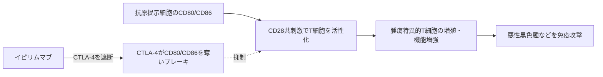

# イピリムマブ（Yervoy／ヤーボイ）

## まず3行で

- 切除不能・転移性悪性黒色腫を起点に、複数の進行がんへ使われる免疫チェックポイント阻害抗体である。
- T細胞上のCTLA-4とCD80/CD86の結合を遮断し、抗原提示時のT細胞活性化にかかるブレーキを緩める。
- 腫瘍そのものではなく免疫寛容の調節分子を狙い、持続的な抗腫瘍免疫が全生存期間を延ばし得ることを臨床で実証した。

## 1. どんな病気か

悪性黒色腫はメラノサイト由来のがんで、皮膚病変のほかリンパ節、肺、肝、脳などへ転移する。紫外線によるDNA損傷を背景に、`BRAF`、`NRAS`などの異常が増殖を駆動する一方、変異由来抗原を認識するT細胞も生じ得る。しかし、抗原があっても免疫抑制性の腫瘍微小環境とチェックポイントが反応を抑える。[NCI PDQ](https://www.cancer.gov/types/skin/hp/melanoma-treatment-pdq)

従来の化学療法は進行例の生存を大きく変えにくく、高用量IL-2は少数で長期奏効するものの毒性が強かった。病因は腫瘍細胞の遺伝子異常だけでなく、免疫が腫瘍を排除し切れないことにもある。ただし、誰が長期奏効するかを正確に選ぶバイオマーカーは今も確立していない。

## 2. なぜこの分子を標的にするのか

T細胞が十分に活性化するには、T細胞受容体による抗原認識に加え、CD28と抗原提示細胞上CD80/CD86の共刺激が要る。CTLA-4は活性化T細胞で誘導され、制御性T細胞（Treg）では恒常的に高く発現する。CD28と同じリガンドへ競合し、さらにCD80/CD86を抗原提示細胞から取り込んで分解することで共刺激を弱める。[Qureshiら](https://pubmed.ncbi.nlm.nih.gov/21474713/)

CTLA-4遮断は特定の腫瘍抗原に依存せず、リンパ節でのT細胞初期活性化を広く増幅できる。反面、CTLA-4は自己寛容を守る生理的ブレーキでもあり、阻害すれば正常臓器に対する免疫反応まで解放される。この治療域の狭さが標的の本質的な弱点である。

## 3. どんな抗体として設計されたか

### 開発企業

MedarexがUltiMAb完全ヒト抗体技術でMDX-010を創製し、2004年からBristol Myers Squibb（BMS）と世界共同開発・商業化を進めた。BMSは2009年にMedarexを買収し、承認・販売を承継した。[Medarex年次報告書](https://www.sec.gov/Archives/edgar/data/874255/000110465905011363/a05-4545_110k.htm)

### 基本設計と作用の仕組み

約148 kDaの完全ヒトIgG1κ抗体で、CHO細胞で製造される。CTLA-4の細胞外領域に結合してCD80/CD86との相互作用を妨げ、腫瘍抗原特異的T細胞の増殖・活性化・細胞傷害を高める。悪性黒色腫では通常3 mg/kgを3週ごとに計4回、30分かけて静注する。[PMDA電子添文](https://www.pmda.go.jp/PmdaSearch/iyakuDetail/670605_4291430A1026_1_32)

### 設計上の工夫

腫瘍細胞へ薬物を運ぶのではなく、免疫系の抑制受容体を二価抗体で占有する設計である。IgG1 Fcを保持するため、前臨床モデルではFcγ受容体を介する腫瘍内Treg除去も抗腫瘍作用に寄与し得る。一方、患者腫瘍ではイピリムマブ後にFOXP3陽性Tregが有意に減らないとの結果があり、臨床効果を「Treg除去」と断定できない。[Sharmaら](https://pubmed.ncbi.nlm.nih.gov/30054281/) 確立した主作用はCTLA-4遮断によるT細胞活性化で、Fcの寄与は腫瘍環境に依存する未解明部分である。

## 4. 病態から作用まで

## 5. 何が画期的だったのか

マウスでCTLA-4遮断が既存腫瘍を拒絶させるという発見を、腫瘍非依存的な治療原理へ翻訳した。[Leachら](https://pubmed.ncbi.nlm.nih.gov/8596936/) 進行悪性黒色腫の無作為化試験では、奏効率は高くなくても一部で反応が持続し、対照群より全生存期間を延長した。[Hodiら](https://pubmed.ncbi.nlm.nih.gov/20525992/) これは「がん細胞を直接殺す」設計から、「免疫の制動を解除して患者自身のT細胞に任せる」設計への転換を承認薬として定着させた。

> **一言で評価：** この抗体の革新性は、CTLA-4という自己寛容のブレーキを治療標的に変え、持続的ながん免疫を臨床利益へ結び付けたことにある。

## 6. 実際の医療での位置づけ

2026年11月4日時点、日本では悪性黒色腫で単剤またはニボルマブ併用が可能で、腎細胞がん、MSI-High結腸・直腸がん、非小細胞肺がん、悪性胸膜中皮腫、食道がん、肝細胞がんでは主にニボルマブ、適応により化学療法と組み合わせる。[PMDA電子添文](https://www.pmda.go.jp/PmdaSearch/iyakuDetail/670605_4291430A1026_1_32) 現在はPD-1阻害薬が多くの場面で単剤の中心となり、イピリムマブは短期導入または二重チェックポイント阻害として効果を上乗せしたい患者で重要である。

最大の制約は免疫関連有害事象である。大腸炎・消化管穿孔、肝障害、皮膚障害、下垂体炎などが起こり、投与終了数カ月後にも発現し得る。早期発見、休薬・中止、全身性ステロイドなどが必要で、自己免疫疾患や臓器移植歴では特に慎重な判断を要する。これは標的外毒性ではなく、CTLA-4が担う正常な免疫寛容を外すオンターゲット毒性である。

## 7. 類薬との違い

| 項目 | イピリムマブ | ニボルマブ | トレメリムマブ |
|---|---|---|---|
| 標的 | CTLA-4 | PD-1 | CTLA-4 |
| 抗体形式 | 完全ヒトIgG1κ | 完全ヒトIgG4κ、ヒンジ安定化 | 完全ヒトIgG2 |
| 主な作用段階 | 抗原提示・初期活性化の増幅 | 腫瘍局所での疲弊T細胞再活性化 | CTLA-4遮断 |
| Fcの特徴 | エフェクター能を残す | エフェクター能を抑える設計 | IgG2で相対的に低いエフェクター能 |
| 主な使い方 | 黒色腫単剤、ニボルマブ併用 | 単剤または多様な併用 | デュルバルマブとの限定回数併用 |
| 主な制約 | 免疫毒性が強い | 免疫毒性、獲得耐性 | 免疫毒性、適応・併用が限定的 |

最も重要な差は作用する免疫段階とFc設計である。CTLA-4阻害は免疫反応の入口を広く動かすため、PD-1阻害より毒性が強い一方、併用では非重複なブレーキを同時に外せる。

## 8. この抗体から学べること

- **疾患生物学：** 腫瘍変異だけでなく、T細胞を抑える免疫寛容も治療可能な病態である。
- **標的選択：** 腫瘍に発現しない分子でも、免疫反応の律速点なら広いがん種へ展開できる。
- **抗体設計：** 同じチェックポイント遮断でもIgGサブクラスがFc作用と安全性仮説を変える。
- **残る課題：** 長期奏効を予測する指標、Treg除去におけるFcの実際の寄与、免疫毒性との分離。
- **次に読む抗体：** エフェクター機能を抑えたPD-1阻害抗体ニボルマブ、別の疲弊経路を狙うLAG-3阻害抗体レラトリマブ。

## 参考文献

1. ヤーボイ点滴静注液20 mg／50 mg 電子添文（2026年9月改訂）. 医薬品医療機器総合機構, 2026. [PMDA](https://www.pmda.go.jp/PmdaSearch/iyakuDetail/670605_4291430A1026_1_32)（2026年11月4日アクセス）
2. YERVOY BLA Approval Letter. U.S. Food and Drug Administration, 2011. [FDA](https://www.accessdata.fda.gov/drugsatfda_docs/appletter/2011/125377s000ltr.pdf)（2026年11月4日アクセス）
3. YERVOY BLA Summary Review. U.S. Food and Drug Administration, 2011. [FDA](https://www.accessdata.fda.gov/drugsatfda_docs/nda/2011/125377Orig1s000SumR.pdf)（2026年11月4日アクセス）
4. Melanoma Treatment (PDQ®)–Health Professional Version. National Cancer Institute. [NCI](https://www.cancer.gov/types/skin/hp/melanoma-treatment-pdq)（2026年11月4日アクセス）
5. Leach DR, et al. Enhancement of antitumor immunity by CTLA-4 blockade. *Science*. 1996;271:1734–1736. [PubMed](https://pubmed.ncbi.nlm.nih.gov/8596936/)
6. Qureshi OS, et al. Trans-endocytosis of CD80 and CD86: a molecular basis for the cell-extrinsic function of CTLA-4. *Science*. 2011;332:600–603. [PubMed](https://pubmed.ncbi.nlm.nih.gov/21474713/)
7. Hodi FS, et al. Improved survival with ipilimumab in patients with metastatic melanoma. *N Engl J Med*. 2010;363:711–723. [PubMed](https://pubmed.ncbi.nlm.nih.gov/20525992/)
8. Sharma A, et al. Anti-CTLA-4 Immunotherapy Does Not Deplete FOXP3+ Regulatory T Cells in Human Cancers. *Clin Cancer Res*. 2019;25:1233–1238. [PubMed](https://pubmed.ncbi.nlm.nih.gov/30054281/)
9. Medarex, Inc. Annual Report 2004（MDX-010 development and BMS collaboration）. U.S. Securities and Exchange Commission, 2005. [SEC](https://www.sec.gov/Archives/edgar/data/874255/000110465905011363/a05-4545_110k.htm)（2026年11月4日アクセス）
10. IMJUDO Prescribing Information（2026年9月改訂）. U.S. Food and Drug Administration, 2026. [FDA](https://www.accessdata.fda.gov/drugsatfda_docs/label/2026/761289s009lbl.pdf)（2026年11月4日アクセス）
