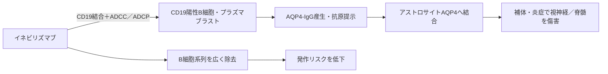

# イネビリズマブ（Uplizna／ユプリズナ）

## まず3行で

- 抗AQP4抗体陽性の視神経脊髄炎スペクトラム障害（NMOSD）を中心に、自己抗体が関わる免疫疾患の再発・再燃を抑える抗体である。
- B細胞系譜に広く発現するCD19へ結合し、低フコース化IgG1 FcでADCCを強め、プラズマブラストを含むCD19陽性細胞を除去する。
- 病原性抗体を生む細胞系列を抗CD20抗体より広く狙う設計を、6カ月ごとの維持投与で実用化した点が重要である。

## 1. どんな病気か

NMOSDは、視神経炎による視力低下・失明や、横断性脊髄炎による麻痺、感覚障害、膀胱直腸障害を反復する中枢神経の自己免疫疾患である。多くの患者では、アストロサイト終足に多い水チャネルAQP4に対するIgGが認められる。[MedlinePlus](https://medlineplus.gov/ency/article/007809.htm)

AQP4-IgGが血液脳関門を越えてAQP4へ結合すると、補体活性化と炎症細胞の動員によりアストロサイトが傷害され、二次的に脱髄と軸索障害が進む。患者IgGが動物でNMO様病変を増悪させるため抗体の病原性は確立しているが、自己寛容が破綻する起点や抗体が中枢へ入る条件は未解明である。[Bradlら](https://pubmed.ncbi.nlm.nih.gov/19937948/) 発作ごとに不可逆的障害が蓄積し得るため、既発作の鎮静化だけでなく次の発作を防ぐ長期治療が要る。

## 2. なぜこの分子を標的にするのか

CD19はpro-B細胞から成熟B細胞、抗体産生へ分化中のプラズマブラスト、一部の形質細胞まで発現する共受容体で、B細胞受容体シグナルの閾値を調節する。CD19陽性細胞を除去すれば、AQP4-IgGの供給候補に加え、抗原提示や炎症性サイトカインを担うB細胞もまとめて減らせる。

CD20は多くの成熟B細胞に発現する一方、プラズマブラスト・形質細胞では低下または消失する。CD19はより広い分化段階を覆うことが長所だが、正常な抗体産生と免疫記憶も損なう。さらにCD19陰性の長寿命形質細胞は残り得るため、全自己抗体を消す設計ではない。臨床解析でもB細胞減少と発作抑制は確認された一方、AQP4-IgG抗体価の変化だけでは発作を説明できず、どのB細胞機能が主要な治療効果を担うかは完全には定まっていない。[Bennettら](https://pubmed.ncbi.nlm.nih.gov/39222408/)

## 3. どんな抗体として設計されたか

### 開発企業

MedImmuneがMEDI-551として創製・初期開発し、2018年に開発資産を引き継いだViela BioがNMOSDの国際試験と米国承認申請を主導した。三菱田辺製薬は2019年に日本を含む地域の共同開発・商業化権を取得し、国内承認を担った。[Viela Bio年次報告書](https://www.sec.gov/Archives/edgar/data/1734517/000156459020012848/vie-10k_20191231.htm)

### 基本設計と作用の仕組み

約149 kDaのヒト化IgG1κ抗体で、CHO細胞により製造される。親和性を最適化したFabでCD19へ結合し、NK細胞のFcγRIIIaを介するADCCと、マクロファージによるADCPで標的細胞を除去する。CDCは検出されていない。通常は300 mgを初回と2週後に静注し、その後は初回から6カ月後、以降6カ月ごとに投与する。[PMDA電子添文](https://www.pmda.go.jp/PmdaSearch/iyakuDetail/400315_6399429A1026_1_08)

### 設計上の工夫

Fc糖鎖のコアフコースを減らしてFcγRIIIaへの結合とADCCを高めた。これはCD19密度の異なるB細胞系列を、補体に依存せず強く除去するための設計である。前臨床ではフコース化親抗体やリツキシマブより低濃度で血中・組織B細胞を減らし、骨髄のB細胞・形質細胞にも作用した。[Herbstら](https://pubmed.ncbi.nlm.nih.gov/20605905/) 反面、強く長い除去作用そのものが低ガンマグロブリン血症と感染リスクにつながる。

## 4. 病態から作用まで

## 5. 何が画期的だったのか

本剤は、病原性AQP4-IgGを中和するのではなく、その産生・維持に関わる細胞系列へ治療点を上流化した。無作為化試験全体ではNMOSD発作がイネビリズマブ群21/174例、プラセボ群22/56例で、抗AQP4抗体陽性部分集団での発作リスク低下が承認根拠となった。[Creeら](https://pubmed.ncbi.nlm.nih.gov/31495497/) CD19という分化範囲の広い標的と、低フコースFcによる除去能を組み合わせたことで、自己抗体疾患に共通するB細胞系列制御へ適応を広げられる設計でもある。

> **一言で評価：** この抗体の革新性は、病原性自己抗体の「産物」ではなく、それを支えるCD19陽性細胞系列を広く、強く、長く除去する設計にある。

## 6. 実際の医療での位置づけ

2026年11月6日時点の日本では、抗AQP4抗体陽性NMOSDの再発予防、IgG4関連疾患の再燃抑制、既存免疫抑制治療が不十分な全身型重症筋無力症に用いる。NMOSDでは単剤で半年ごとの維持が可能だが、発作時の急性期治療の代わりではない。[PMDA電子添文](https://www.pmda.go.jp/PmdaSearch/iyakuDetail/400315_6399429A1026_1_08)

重要な有害事象はinfusion reaction、感染症、免疫グロブリン低下、血球減少である。投与前にB型肝炎・結核・免疫グロブリンを評価し、ワクチン計画も整える。反復投与ではIgG低下を追跡し、重い感染や遷延する低IgGとの釣り合いを再評価する必要がある。これはCD19陽性細胞を広く除去する設計に直結した制約である。

## 7. 類薬との違い

| 項目 | イネビリズマブ | リツキシマブ | サトラリズマブ | エクリズマブ |
|---|---|---|---|---|
| 標的 | CD19 | CD20 | IL-6受容体 | 補体C5 |
| 抗体形式 | 低フコース化ヒト化IgG1 | キメラIgG1 | リサイクリング型ヒト化IgG2 | IgG2/IgG4ハイブリッド |
| 主作用 | B細胞～プラズマブラスト除去 | 主に成熟B細胞除去 | 炎症シグナル遮断 | 終末補体遮断 |
| 投与 | 静注、6カ月ごと | 静注、NMOSDでは適応外使用 | 皮下注、4週ごと | 静注、2週ごと |
| 主な弱点 | 感染、低IgG | 感染、infusion reaction | 感染、好中球減少 | 髄膜炎菌感染 |

最も重要なのは病態連鎖のどこを切るかである。イネビリズマブは自己抗体産生側を広く抑え、サトラリズマブはIL-6依存性炎症、エクリズマブはAQP4-IgGより下流の補体傷害を抑える。リツキシマブとの差は、CD19がプラズマブラストまで覆う点と、低フコースFcで除去能を高めた点にある。

## 8. この抗体から学べること

- **疾患生物学：** NMOSDは脱髄疾患というより、AQP4-IgGを起点とする自己免疫性アストロサイト障害として理解できる。
- **標的選択：** 分泌された自己抗体だけでなく、その産生細胞の分化範囲を見て標的を選べる。
- **抗体設計：** 低フコース化はFcγRIIIa依存性の細胞除去を強める一方、低IgGと感染という代償も大きくする。
- **残る課題：** 有効性を担うB細胞サブセット、長期低IgGの管理、治療中止・切替時期の指標。
- **次に読む抗体：** IL-6Rを遮断するサトラリズマブ、終末補体を止めるエクリズマブ。

## 参考文献

1. ユプリズナ点滴静注100 mg 電子添文（第5版）. 医薬品医療機器総合機構, 2026. [PMDA](https://www.pmda.go.jp/PmdaSearch/iyakuDetail/400315_6399429A1026_1_08)（2026年11月6日アクセス）
2. UPLIZNA Prescribing Information. U.S. Food and Drug Administration / DailyMed, 2025. [DailyMed](https://dailymed.nlm.nih.gov/dailymed/drugInfo.cfm?setid=834db232-afb0-4dcf-93e0-009ce8245c20)（2026年11月6日アクセス）
3. UPLIZNA Pharmacology/Toxicology Review. U.S. Food and Drug Administration, 2020. [FDA](https://www.accessdata.fda.gov/drugsatfda_docs/nda/2020/761142Orig1s000PharmR.pdf)（2026年11月6日アクセス）
4. Neuromyelitis Optica Spectrum Disorder. MedlinePlus Medical Encyclopedia, U.S. National Library of Medicine. [MedlinePlus](https://medlineplus.gov/ency/article/007809.htm)（2026年11月6日アクセス）
5. Bradl M, et al. Neuromyelitis optica: pathogenicity of patient immunoglobulin in vivo. *Ann Neurol*. 2009;66:630–643. [PubMed](https://pubmed.ncbi.nlm.nih.gov/19937948/)
6. Herbst R, et al. B-cell depletion in vitro and in vivo with an afucosylated anti-CD19 antibody. *J Pharmacol Exp Ther*. 2010;335:213–222. [PubMed](https://pubmed.ncbi.nlm.nih.gov/20605905/)
7. Chen D, et al. Single dose of glycoengineered anti-CD19 antibody (MEDI551) disrupts experimental autoimmune encephalomyelitis. *J Immunol*. 2014;193:4823–4832. [PubMed](https://pubmed.ncbi.nlm.nih.gov/25281717/)
8. Cree BAC, et al. Inebilizumab for the treatment of neuromyelitis optica spectrum disorder (N-MOmentum). *Lancet*. 2019;394:1352–1363. [PubMed](https://pubmed.ncbi.nlm.nih.gov/31495497/)
9. Bennett JL, et al. B cell and aquaporin-4 antibody relationships with neuromyelitis optica spectrum disorder activity. *Ann Clin Transl Neurol*. 2024;11:2792–2798. [PubMed](https://pubmed.ncbi.nlm.nih.gov/39222408/)
10. Viela Bio, Inc. Annual Report 2019（inebilizumab development and MTPC agreement）. U.S. Securities and Exchange Commission, 2020. [SEC](https://www.sec.gov/Archives/edgar/data/1734517/000156459020012848/vie-10k_20191231.htm)（2026年11月6日アクセス）
