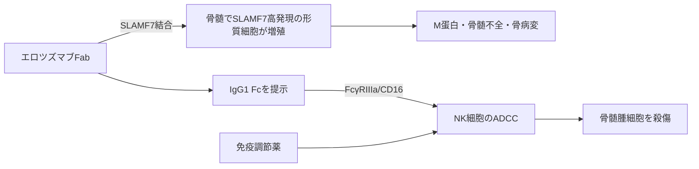

# エロツズマブ（Empliciti／エムプリシティ）

## まず3行で

- 再発・難治性の多発性骨髄腫で、免疫調節薬・デキサメタゾンと併用する抗体である。
- 骨髄腫細胞とNK細胞に発現するSLAMF7へ結合し、主にIgG1 Fcを介するNK細胞のADCCで腫瘍細胞を殺傷する。
- 腫瘍抗原を標識するFabと、同じ標的を持つ免疫細胞を動員するFc／共刺激を一つの抗体で結び、骨髄腫の免疫療法を実用化した点が重要である。

## 1. どんな病気か

多発性骨髄腫は、抗体を分泌する形質細胞が骨髄でクローン性に増殖する血液がんである。異常免疫グロブリン（M蛋白）や軽鎖、骨髄占拠、破骨細胞優位の骨代謝が、腎障害、貧血、骨痛・骨折、高カルシウム血症をもたらす。正常抗体の産生低下も重なり感染しやすくなる。[NCI](https://www.cancer.gov/types/myeloma/patient/myeloma-treatment-pdq)

遺伝子異常とクローン構成は患者内でも変化し、骨髄間質や免疫抑制性微小環境が腫瘍を支える。プロテアソーム阻害薬、免疫調節薬、移植などで深い奏効が得られても、残存クローンや薬剤耐性により再発を繰り返すことが多い。このため、増殖経路をもう一つ阻害するだけでなく、表面抗原を手掛かりに免疫細胞へ殺傷を委ねる戦略が求められた。

## 2. なぜこの分子を標的にするのか

SLAMF7（CS1／CD319）は免疫グロブリンスーパーファミリーの接着・シグナル分子で、骨髄腫細胞に高頻度かつ高密度に発現し、造血幹細胞や多くの正常組織では乏しい。病期や代表的な細胞遺伝学的異常をまたいで発現が保たれるため、標識抗原として使いやすい。[Hsiら](https://pubmed.ncbi.nlm.nih.gov/18451245/)

一方、SLAMF7は正常形質細胞やNK細胞にも発現する。NK細胞ではアダプターEAT-2と結びつき活性化を補助するが、骨髄腫細胞ではEAT-2やCD45を欠くことが多く、抗体結合だけで腫瘍増殖を刺激するシグナルは確認されていない。[Guoら](https://pubmed.ncbi.nlm.nih.gov/25312647/) 長所は「腫瘍の目印」と「殺傷細胞の調節分子」が同じことであり、弱点はNK細胞数・機能が低い患者ではFc依存性作用が弱まり得ること、正常形質細胞への影響を完全には避けられないことである。

## 3. どんな抗体として設計されたか

### 開発企業

PDL BioPharmaがマウス抗体MuLuc63をヒト化してHuLuc63を創製し、第1相試験を開始した。2008年からBristol Myers Squibb（BMS）がPDL（のちのFacet Biotech、AbbVie Biotherapeutics）と世界共同開発・商業化を進め、BMSが承認申請を主導した。[PMDA申請資料](https://www.pmda.go.jp/drugs/2016/P20161025001/670605000_22800AMX00698000_B100_1.pdf)

### 基本設計と作用の仕組み

約148 kDaのヒト化IgG1κ通常抗体で、SLAMF7の膜遠位IgC2ドメインへ結合する。Fabが骨髄腫細胞を標識し、FcがNK細胞のFcγRIIIa（CD16）を架橋して脱顆粒を起こすADCCが主要機序で、マクロファージによるADCPも前臨床で示されている。Fc・糖鎖に特別な増強改変はなく、IgG1本来のエフェクター機能を利用する。

### 設計上の工夫

同じSLAMF7を持つNK細胞への結合は、他の活性化受容体と協調する共刺激を加える可能性がある。ただし、Fc結合を失わせた抗体では単独のNK活性化が弱い実験もあり、患者でのCD16非依存性共刺激の寄与は未確定である。[Pazinaら](https://pubmed.ncbi.nlm.nih.gov/28932638/) 単剤の客観的奏効が乏しかったため、NK機能を高める免疫調節薬との併用を前提に開発したことも、分子設計と同じく重要な治療設計である。

## 4. 病態から作用まで

## 5. 何が画期的だったのか

2015年に米国で初承認され、SLAMF7という形質細胞系譜抗原を臨床的に実証した初の免疫刺激性抗体となった。[FDA](https://www.accessdata.fda.gov/scripts/purplebooksearch/index.cfm?blaNo=761035&event=productdetails) 再発・難治例の無作為化試験では、レナリドミド／デキサメタゾンへの追加で無増悪期間だけでなく最終解析の全生存期間も延長した。[Dimopoulosら](https://pubmed.ncbi.nlm.nih.gov/32887873/) 腫瘍細胞へ直接毒性を与えるより、標的選択と併用薬で患者自身のNK細胞を働かせる設計が特徴である。

> **一言で評価：** この抗体の革新性は、SLAMF7を骨髄腫の標識とNK細胞動員の接点にし、自然免疫による殺傷を治療へ組み込んだことにある。

## 6. 実際の医療での位置づけ

2026年11月9日時点の日本では、少なくとも1つの標準治療が無効または再発した多発性骨髄腫に、レナリドミドまたはポマリドミドとデキサメタゾンを組み合わせて静注する。ポマリドミド併用では最初の2サイクルを毎週、その後は20 mg/kgを4週ごとに投与する。単剤薬ではなく、免疫細胞と併用薬が機能する状況を作る治療である。[PMDA電子添文](https://www.pmda.go.jp/PmdaSearch/iyakuDetail/ResultDataSetPDF/670605_4291434D1020_1_07)

重要な有害事象はinfusion reaction、感染症、血球減少で、前投薬と段階的な点滴速度調節を要する。効果は長期に持続し得る一方、点滴負担があり、抗CD38抗体やBCMA標的薬が使える現在は前治療、併存症、免疫状態を踏まえた選択が必要である。

## 7. 類薬との違い

| 項目 | エロツズマブ | ダラツムマブ |
|---|---|---|
| 標的 | SLAMF7 | CD38 |
| 抗体形式 | ヒト化IgG1κ | ヒトIgG1κ |
| 主作用 | NK細胞ADCC、ADCP、共刺激候補 | CDC、ADCC、ADCP、免疫抑制細胞除去 |
| 使用 | 再発・難治例で免疫調節薬と併用 | 未治療から再発例まで、多剤併用または単剤 |
| 強み | SLAMF7高発現、Fc依存性の免疫動員 | 複数の殺傷機序、皮下製剤あり |
| 弱点 | 単剤活性が乏しく静注併用が前提 | 輸血検査干渉、感染・infusion reaction |

最重要の違いは、エロツズマブが主にNK細胞の働きへ依存するのに対し、ダラツムマブは補体を含む複数経路と免疫環境改変を持つ点である。前者では、標的発現だけでなく「エフェクター細胞が働けるか」までが標的選択の一部になる。

## 8. この抗体から学べること

- **疾患生物学：** 骨髄腫は形質細胞クローンだけでなく、骨髄の免疫環境を含む疾患である。
- **標的選択：** 病態の必須ドライバーでなくても、高く安定した表面発現は免疫標識として価値を持つ。
- **抗体設計：** 改変Fcがなくても、Fabの標識とIgG1 FcのADCCを併用薬で増幅できる。
- **残る課題：** 直接的SLAMF7共刺激の臨床寄与、NK機能を予測する指標、最適な治療順序。
- **次に読む抗体：** 異なる形質細胞抗原と複数の殺傷機序を使うダラツムマブ。

## 参考文献

1. エムプリシティ点滴静注用300 mg／400 mg 電子添文（第4版）. 医薬品医療機器総合機構, 2026. [PMDA](https://www.pmda.go.jp/PmdaSearch/iyakuDetail/ResultDataSetPDF/670605_4291434D1020_1_07)（2026年11月9日アクセス）
2. エムプリシティ審査報告書. 医薬品医療機器総合機構, 2016. [PMDA](https://www.pmda.go.jp/drugs/2016/P20161025001/670605000_22800AMX00698000_A100_1.pdf)（2026年11月9日アクセス）
3. Plasma Cell Neoplasms (Including Multiple Myeloma) Treatment (PDQ®). National Cancer Institute. [NCI](https://www.cancer.gov/types/myeloma/patient/myeloma-treatment-pdq)（2026年11月9日アクセス）
4. Hsi ED, et al. CS1, a potential new therapeutic antibody target for the treatment of multiple myeloma. *Clin Cancer Res*. 2008;14:2775–2784. [PubMed](https://pubmed.ncbi.nlm.nih.gov/18451245/)
5. Guo H, et al. Immune cell inhibition by SLAMF7 is mediated by a mechanism requiring Src kinases, CD45, and SHIP-1 that is defective in multiple myeloma cells. *Mol Cell Biol*. 2015;35:41–51. [PubMed](https://pubmed.ncbi.nlm.nih.gov/25312647/)
6. Pazina T, et al. The anti-SLAMF7 antibody elotuzumab mediates NK cell activation through both CD16-dependent and -independent mechanisms. *Oncoimmunology*. 2017;6:e1339853. [PubMed](https://pubmed.ncbi.nlm.nih.gov/28932638/)
7. Dimopoulos MA, et al. Elotuzumab therapy for relapsed or refractory multiple myeloma. *N Engl J Med*. 2015;373:621–631. [DOI](https://doi.org/10.1056/NEJMoa1505654)
8. Dimopoulos MA, et al. Elotuzumab, lenalidomide, and dexamethasone in RRMM: final overall survival results from ELOQUENT-2. *Blood Cancer J*. 2020;10:91. [PubMed](https://pubmed.ncbi.nlm.nih.gov/32887873/)
9. Bristol-Myers Squibb and PDL BioPharma Enter Global Alliance to Develop Novel Treatment for Multiple Myeloma. Bristol Myers Squibb, 2008. [BMS](https://news.bms.com/news/details/2008/Bristol-Myers-Squibb-and-PDL-BioPharma-Enter-Global-Alliance-to-Develop-Novel-Treatment-for-Multiple-Myeloma/default.aspx)（2026年11月9日アクセス）
10. DARZQURO Combination Subcutaneous Injection Prescribing Information. 医薬品医療機器総合機構, 2025. [PMDA](https://www.pmda.go.jp/PmdaSearch/iyakuDetail/ResultDataSetPDF/800155_4291500A1023_1_09)（2026年11月9日アクセス）
