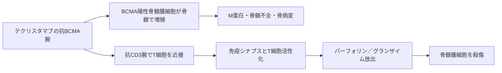

# テクリスタマブ（Tecvayli／テクベイリ）

## まず3行で

- 再発・難治性多発性骨髄腫に用いる、皮下注射の二重特異性抗体である。
- 骨髄腫細胞のBCMAとT細胞のCD3を同時に結び、人工的な免疫シナプスを作ってT細胞に腫瘍細胞を殺傷させる。
- BCMA標的T細胞リダイレクトを、個別製造不要の完全長IgGとして初めて承認へ導いた点が重要である。

## 1. どんな病気か

多発性骨髄腫は、抗体を作る形質細胞が骨髄でクローン性に増殖する血液がんである。骨髄占拠と異常免疫グロブリン（M蛋白）・遊離軽鎖が、貧血、骨痛・骨折、高カルシウム血症、腎障害を起こす。正常免疫グロブリンの産生も抑えられ、感染防御が弱くなる。[NCI](https://www.cancer.gov/types/myeloma/patient/myeloma-treatment-pdq)

プロテアソーム阻害薬、免疫調節薬、抗CD38抗体、移植で深い奏効を得ても、遺伝的に不均一な残存クローンが選択され、再発を重ねる。既存薬への耐性機序を迂回し、骨髄内のT細胞を直接「殺傷装置」として使うことが開発課題だった。一方、反応の深さは腫瘍量、抗原量、T細胞の量・疲弊状態などに左右され、その寄与の全体像はなお未解明である。

## 2. なぜこの分子を標的にするのか

BCMA（TNFRSF17）はTNF受容体ファミリーの膜蛋白で、主に形質芽細胞・形質細胞と骨髄腫細胞に発現する。APRILやBAFFが結合するとNF-κB、AKT、MAPKなどの生存シグナルを伝え、骨髄腫モデルでは増殖・免疫抑制を促す。[Taiら](https://pmc.ncbi.nlm.nih.gov/articles/PMC4920023/) ただし、BCMAが全骨髄腫の絶対的ドライバーだからではなく、正常組織で発現が比較的限られ、細胞表面に提示される「形質細胞系列の住所」であることが最大の標的価値である。

弱点も同じ選択性から生じる。正常形質細胞も傷害されるため低γグロブリン血症と重篤感染につながり、BCMAの切断で生じる可溶性BCMAは抗体を捕捉し得る。また、治療後のBCMA低下やTNFRSF17変異・欠失は抗原逃避となるが、頻度や最適な事前検査は確立していない。[Leeら](https://pmc.ncbi.nlm.nih.gov/articles/PMC11302451/)

## 3. どんな抗体として設計されたか

### 開発企業

Genmabは二つの親抗体から二重特異性IgGを作るDuoBody技術を提供し、Janssenが標的対を選び、テクリスタマブを創製・前臨床開発・臨床開発した。両社のDuoBody共同研究は2012年に始まった。[Genmab](https://www.genmab.com/antibody-science/antibody-technology-platforms/duobody)

### 基本設計と作用の仕組み

約146 kDaのヒト化IgG4型1+1二重特異性抗体で、片腕がBCMA、もう片腕がT細胞受容体複合体のCD3εへ結合する。二つの親IgGを別々に作り、制御Fab-arm交換で正しい異種重鎖対を組み立てる。架橋されたT細胞は本来の抗原特異性や腫瘍のMHC提示に依存せず活性化し、パーフォリンとグランザイムでBCMA陽性細胞を殺す。[Pillarisettiら](https://pmc.ncbi.nlm.nih.gov/articles/PMC7509877/)

### 設計上の工夫

IgG4のS228Pはヒンジを安定化し、F234A/L235A（PAA）はFcγ受容体結合とADCCを弱める。これはFcを介した無秩序なCD3架橋を避け、腫瘍抗原依存的なT細胞活性化へ寄せるためである。CH3界面の相補的置換は製造時の異種重鎖形成を促し、完全長Fcは抗体様の体内滞留を与える。皮下投与と漸増投与は急なサイトカイン放出を抑える治療設計であり、奏効持続後は投与間隔を延長できる。[EMA評価報告書](https://www.ema.europa.eu/en/documents/assessment-report/tecvayli-epar-public-assessment-report_en.pdf)

## 4. 病態から作用まで

## 5. 何が画期的だったのか

2022年に欧州で初承認され、BCMA×CD3二重特異性抗体という新しい骨髄腫治療クラスを実用化した。患者ごとに細胞採取・遺伝子改変・製造を要するCAR-T療法と異なり、在庫可能な抗体を皮下注射してT細胞リダイレクトを開始できる。多治療歴例の単群試験では63%が奏効し、39.4%が完全奏効以上に達したが、比較試験ではない点に注意が要る。[Moreauら](https://pmc.ncbi.nlm.nih.gov/articles/PMC10587778/)

> **一言で評価：** この抗体の革新性は、形質細胞系列に偏るBCMAを足場に、既製品の完全長IgGで患者自身のT細胞を骨髄腫へ振り向けたことにある。

## 6. 実際の医療での位置づけ

2026年11月12日時点の日本では、少なくとも1つの標準治療が無効または再発した多発性骨髄腫に用いる。単剤のほかダラツムマブ配合皮下注との併用、髄外性形質細胞腫を有する所定の患者ではトアルクエタマブとの併用が設定されている。単剤は0.06、0.3、1.5 mg/kgと漸増後、週1回皮下注し、部分奏効以上が24週間続けば2週ごとへ延長できる。[PMDA電子添文](https://www.pmda.go.jp/PmdaSearch/iyakuDetail/ResultDataSetPDF/800155_4291475A1023_1_03)

重要な毒性はサイトカイン放出症候群（CRS）、ICANSなどの神経毒性、血球減少、感染症、低γグロブリン血症である。初期は前投薬、漸増、入院管理等を要し、感染予防と免疫グロブリン値の監視が長期使用の要点になる。米国では2026年にダラツムマブ併用が前治療1ライン以上へ承認され、単剤の迅速承認も通常承認へ移行した。[FDA](https://www.fda.gov/drugs/cancer-approvals/fda-approves-teclistamab-combination-daratumumab-hyaluronidase-fihj-relapsed-or-refractory-multiple)

## 7. 類薬との違い

| 項目 | テクリスタマブ | トアルクエタマブ |
|---|---|---|
| 腫瘍側標的 | BCMA | GPRC5D |
| T細胞側標的 | CD3 | CD3 |
| 抗体形式 | ヒト化IgG4 1+1 DuoBody | ヒト化IgG4 1+1 DuoBody |
| 強み | 形質細胞系列に偏った発現、豊富な臨床経験 | BCMA治療後の別抗原ルートになり得る |
| 主な標的関連毒性 | 正常形質細胞減少、低γグロブリン血症・感染 | 味覚、口腔、皮膚・爪の障害 |
| 共通課題 | CRS、ICANS、感染、抗原逃避 | CRS、ICANS、感染、抗原逃避 |

最重要の違いは正常組織での抗原分布である。BCMAは感染防御を担う形質細胞、GPRC5Dは皮膚・舌などの上皮にも発現するため、同じCD3リダイレクトでも毒性の輪郭が変わる。両者の併用は抗原逃避を補う反面、T細胞活性化と感染の管理をより複雑にする。[タービー電子添文](https://www.pmda.go.jp/PmdaSearch/iyakuDetail/ResultDataSetPDF/800155_4291480A1024_1_02)

## 8. この抗体から学べること

- **疾患生物学：** 骨髄腫は形質細胞の系譜抗原と骨髄内T細胞の双方を利用できるが、正常抗体産生も巻き込む。
- **標的選択：** 必須ドライバーでなくても、系譜選択的な表面発現は細胞傷害の住所として価値を持つ。
- **抗体設計：** 二重特異性、Fcサイレンシング、皮下・漸増投与は一体で安全なT細胞架橋を成立させる。
- **残る課題：** 感染予防、最適な休薬・間隔延長、T細胞疲弊とBCMA抗原逃避の予測。
- **次に読む抗体：** 別の骨髄腫抗原GPRC5DへT細胞を向けるトアルクエタマブ。

## 参考文献

1. テクベイリ皮下注30 mg／153 mg 電子添文（第3版）. 医薬品医療機器総合機構, 2026. [PMDA](https://www.pmda.go.jp/PmdaSearch/iyakuDetail/ResultDataSetPDF/800155_4291475A1023_1_03)（2026年11月12日アクセス）
2. Tecvayli: EPAR Public Assessment Report. European Medicines Agency, 2022. [EMA](https://www.ema.europa.eu/en/documents/assessment-report/tecvayli-epar-public-assessment-report_en.pdf)（2026年11月12日アクセス）
3. FDA approves teclistamab in combination with daratumumab hyaluronidase-fihj for relapsed or refractory multiple myeloma. U.S. Food and Drug Administration, 2026. [FDA](https://www.fda.gov/drugs/cancer-approvals/fda-approves-teclistamab-combination-daratumumab-hyaluronidase-fihj-relapsed-or-refractory-multiple)（2026年11月12日アクセス）
4. Plasma Cell Neoplasms (Including Multiple Myeloma) Treatment (PDQ®). National Cancer Institute. [NCI](https://www.cancer.gov/types/myeloma/patient/myeloma-treatment-pdq)（2026年11月12日アクセス）
5. Pillarisetti K, et al. Teclistamab is an active T cell-redirecting bispecific antibody against B-cell maturation antigen for multiple myeloma. *Blood Adv*. 2020;4:4538–4549. [PubMed](https://pubmed.ncbi.nlm.nih.gov/32956453/)
6. Tai YT, et al. APRIL and BCMA promote human multiple myeloma growth and immunosuppression in the bone marrow microenvironment. *Blood*. 2016;127:3225–3236. [PMC](https://pmc.ncbi.nlm.nih.gov/articles/PMC4920023/)
7. Moreau P, et al. Teclistamab in relapsed or refractory multiple myeloma. *N Engl J Med*. 2022;387:495–505. [PMC](https://pmc.ncbi.nlm.nih.gov/articles/PMC10587778/)
8. Firestone RS, et al. Antigen escape as a shared mechanism of resistance to BCMA-directed therapies in multiple myeloma. *Blood*. 2024;144:402–407. [PMC](https://pmc.ncbi.nlm.nih.gov/articles/PMC11302451/)
9. DuoBody® biotechnology platform. Genmab. [Genmab](https://www.genmab.com/antibody-science/antibody-technology-platforms/duobody)（2026年11月12日アクセス）
10. タービー皮下注3 mg／40 mg 電子添文（第2版）. 医薬品医療機器総合機構, 2026. [PMDA](https://www.pmda.go.jp/PmdaSearch/iyakuDetail/ResultDataSetPDF/800155_4291480A1024_1_02)（2026年11月12日アクセス）
