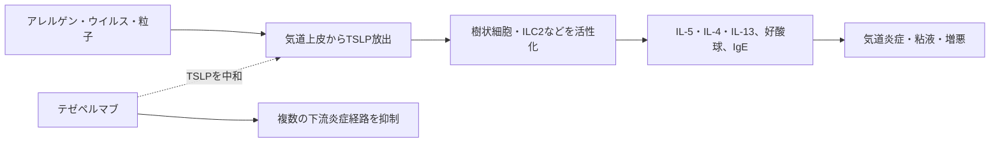

# テゼペルマブ（Tezspire／テゼスパイア）

## まず3行で

- 吸入薬などで制御できない重症喘息に追加し、増悪を抑える抗体である。
- 気道上皮が刺激に応じて放出するTSLPを捕捉し、TSLPRとIL-7Rαからなる受容体への結合を遮断する。
- 好酸球やIgEなど一つの下流因子ではなく、炎症の入口となる上皮アラーミンを狙い、特定の喘息表現型に限定しない生物学的製剤を実現した点が重要である。

## 1. どんな病気か

喘息は、気道の慢性炎症と変動する気流制限により、喘鳴、咳、胸部圧迫感、息苦しさを繰り返す疾患である。アレルゲン、ウイルス、煙・粒子などが増悪の引き金になる。吸入ステロイド薬と長時間作用性気管支拡張薬を適切に使っても増悪する重症例では、全身性ステロイド薬の毒性を避けながら炎症の起点を抑える必要がある。[FDA](https://www.fda.gov/drugs/news-events-human-drugs/fda-approves-maintenance-treatment-severe-asthma)

喘息は単一の病態ではない。典型的な2型炎症では、Th2細胞や2型自然リンパ球がIL-5、IL-4、IL-13を介して好酸球、IgE、粘液産生を増やす。一方、血中好酸球やアレルギー指標が低い患者にも増悪は起こる。気道上皮は単なる物理的壁ではなく、外界の損傷をTSLPなどの「アラーミン」に変換して樹状細胞、肥満細胞、好塩基球、好酸球、リンパ球へ伝える。この上流信号なら複数の下流経路をまとめて弱められる、というのが開発仮説だった。ただし、TSLP遮断後の臨床反応を一つの検査で予測する方法や、非2型炎症への寄与は確立していない。

## 2. なぜこの分子を標的にするのか

TSLPは主に肺・皮膚・腸などの上皮細胞から放出されるサイトカインである。TSLPR（CRLF2）へ先に結合してIL-7Rαを呼び込み、STAT5などを活性化する。ウイルスを模した二本鎖RNAとTh2サイトカインはヒト気道上皮のTSLP産生を誘導し、上皮障害と免疫反応をつなぐ。[Katoら](https://pubmed.ncbi.nlm.nih.gov/17617600/)

可溶性リガンドを中和すれば、多様な免疫細胞を直接除去せずに炎症カスケードの入口を閉じられる。構造解析ではテゼペルマブの重鎖CDRがTSLPのTSLPR結合面と競合し、反対側のIL-7Rα結合面には重ならない。しかしTSLPRが結合できなければ三者複合体は組み上がらない。[Verstraeteら](https://pmc.ncbi.nlm.nih.gov/articles/PMC5382266/) 弱点は、TSLPが粘膜防御や組織恒常性にも関わること、IL-33やIL-25など並行する上皮シグナルは残ることである。

## 3. どんな抗体として設計されたか

### 開発企業

Amgenの臨床炎症パイプラインに由来するAMG 157を、2012年からAstraZenecaと共同開発した。契約ではAstraZenecaが開発・商業戦略を主導し、両社が費用と利益を分担した。[Amgen](https://wwwext.amgen.com/newsroom/press-releases/2012/04/amgen-and-astrazeneca-announce-collaboration-to-jointly-develop-and-commercialize-clinical-stage-inflammation-portfolio)

### 基本設計と作用の仕組み

約147 kDaの完全ヒトIgG2λ通常抗体で、CHO細胞で生産される。TSLPへ高親和性に結合して受容体複合体形成を阻み、下流の樹状細胞活性化、2型自然リンパ球・Th2反応を弱める。その結果、血中・気道好酸球、IgE、呼気一酸化窒素、IL-5、IL-13など複数の炎症指標が低下するが、臨床効果に至る全機序は確定していない。[FDA添付文書](https://www.accessdata.fda.gov/drugsatfda_docs/label/2025/761224s006lbl.pdf)

### 設計上の工夫

細胞表面受容体を架橋・除去する抗体ではなく、可溶性サイトカイン中和を担うIgG2であり、強いFc細胞傷害を主作用としない。公開規制資料上、特別なFc・糖鎖改変、ペイロードはない。210 mgの高濃度プレフィルドシリンジ／ペンを4週ごとに皮下注し、条件を満たせば自己投与できる。工夫の中心は複雑な抗体工学より、病態の上流で持続的にリガンドを占有する標的選択と製剤化にある。[PMDA初回審査](https://www.pmda.go.jp/drugs/2022/P20220929001/670227000_30400AMX00402_A100_1.pdf)

## 4. 病態から作用まで

## 5. 何が画期的だったのか

テゼペルマブは2021年、TSLPを標的とする初の喘息治療として米国で承認された。承認時に好酸球数やアレルギー表現型による適応限定がなく、重症喘息を「下流の病型ごとに一経路ずつ抑える」発想から「上皮と免疫の接点を上流で抑える」発想へ広げた。第III相試験では、幅広いバイオマーカー群で年間増悪率を低下させた。[Menzies-Gowら](https://pubmed.ncbi.nlm.nih.gov/33979488/) ただし反応は一様でなく、経口ステロイド減量試験では全体の主要評価項目を達成しなかったため、万能な上流遮断と解釈すべきではない。[Wechslerら](https://pubmed.ncbi.nlm.nih.gov/35364018/)

> **一言で評価：** この抗体の革新性は、気道上皮由来TSLPを炎症の分岐前で中和し、従来の表現型枠を越える重症喘息治療を成立させたことにある。

## 6. 実際の医療での位置づけ

2026年11月15日時点の日本では、中・高用量吸入ステロイド薬と他の長期管理薬でも増悪する12歳以上の重症・難治性喘息に追加し、210 mgを4週ごとに皮下注する。2026年2月には、全身性ステロイド薬や手術でも制御不十分な成人の鼻茸を伴う慢性副鼻腔炎にも適応が拡大した。[PMDA電子添文](https://www.pmda.go.jp/PmdaSearch/iyakuDetail/ResultDataSetPDF/670227_2290403G1025_1_05)

急性発作を止める薬ではなく、既存の吸入薬や全身ステロイド薬を自己判断で中止しない。重大な注意はアナフィラキシーなどの重篤な過敏症で、咽頭炎、関節痛、注射部位反応などもみられる。開始前に寄生虫感染を治療し、投与中の生ワクチンは避ける。長期注射の負担と費用、確立した反応予測バイオマーカーがないことが実用上の制約である。

## 7. 類薬との違い

| 項目 | テゼペルマブ | オマリズマブ | ベンラリズマブ | デュピルマブ |
|---|---|---|---|---|
| 標的 | TSLP | 遊離IgE | IL-5Rα | IL-4Rα |
| 主作用 | 上皮アラーミン中和 | IgE捕捉 | 好酸球をADCCで除去 | IL-4/IL-13遮断 |
| 選択の軸 | 表現型の限定なし | アレルギー・IgE | 好酸球増多 | 2型炎症・併存疾患 |
| 強み | 複数下流経路を上流で抑える | アレルギー機序へ直結 | 深い好酸球枯渇 | 多臓器の2型炎症を制御 |
| 弱点 | 反応予測が未確立 | 非IgE病態は残る | 非好酸球病態は残る | 好酸球増加などに注意 |

最重要の違いは治療選択の粒度である。下流標的薬はバイオマーカーと合えば機序が明快で、テゼペルマブは表現型が混在・不明瞭でも候補になり得る反面、誰に最も必要かを選ぶ指標が弱い。

## 8. この抗体から学べること

- **疾患生物学：** 喘息では上皮が環境刺激を免疫炎症へ翻訳する能動的な司令塔になる。
- **標的選択：** 分岐前の可溶性因子を狙えば、異質な患者集団で複数の下流経路を同時に弱められる。
- **抗体設計：** 細胞除去ではなく長期中和が目的なら、低エフェクターの通常抗体と皮下製剤で成立する。
- **残る課題：** 反応予測、経口ステロイド減量の確実性、長期TSLP遮断の影響をさらに明らかにする必要がある。
- **次に読む抗体：** 好酸球を直接除去するベンラリズマブ、IL-4/IL-13共有受容体を阻害するデュピルマブ。

## 参考文献

1. テゼスパイア皮下注210 mgシリンジ／ペン 電子添文（第4版）. 医薬品医療機器総合機構, 2026. [PMDA](https://www.pmda.go.jp/PmdaSearch/iyakuDetail/ResultDataSetPDF/670227_2290403G1025_1_05)（2026年11月15日アクセス）
2. テゼスパイア皮下注210 mgシリンジ 審査報告書. 医薬品医療機器総合機構, 2022. [PMDA](https://www.pmda.go.jp/drugs/2022/P20220929001/670227000_30400AMX00402_A100_1.pdf)（2026年11月15日アクセス）
3. TEZSPIRE Prescribing Information. U.S. Food and Drug Administration, 2025. [FDA](https://www.accessdata.fda.gov/drugsatfda_docs/label/2025/761224s006lbl.pdf)（2026年11月15日アクセス）
4. FDA approves maintenance treatment for severe asthma. U.S. Food and Drug Administration, 2021. [FDA](https://www.fda.gov/drugs/news-events-human-drugs/fda-approves-maintenance-treatment-severe-asthma)（2026年11月15日アクセス）
5. Kato A, et al. TLR3- and Th2 cytokine-dependent production of thymic stromal lymphopoietin in human airway epithelial cells. *J Immunol*. 2007;179:1080–1087. [PubMed](https://pubmed.ncbi.nlm.nih.gov/17617600/)
6. Verstraete K, et al. Structure and antagonism of the receptor complex mediated by human TSLP in allergy and asthma. *Nat Commun*. 2017;8:14937. [PMC](https://pmc.ncbi.nlm.nih.gov/articles/PMC5382266/)
7. Gauvreau GM, et al. Effects of an anti-TSLP antibody on allergen-induced asthmatic responses. *N Engl J Med*. 2014;370:2102–2110. [PubMed](https://pubmed.ncbi.nlm.nih.gov/24846652/)
8. Menzies-Gow A, et al. Tezepelumab in adults and adolescents with severe, uncontrolled asthma. *N Engl J Med*. 2021;384:1800–1809. [PubMed](https://pubmed.ncbi.nlm.nih.gov/33979488/)
9. Wechsler ME, et al. Evaluation of the oral corticosteroid-sparing effect of tezepelumab in adults with severe, oral corticosteroid-dependent asthma (SOURCE). *Lancet Respir Med*. 2022;10:650–660. [PubMed](https://pubmed.ncbi.nlm.nih.gov/35364018/)
10. Amgen and AstraZeneca Announce Collaboration to Jointly Develop and Commercialize Clinical-Stage Inflammation Portfolio. Amgen / AstraZeneca, 2012. [Amgen](https://wwwext.amgen.com/newsroom/press-releases/2012/04/amgen-and-astrazeneca-announce-collaboration-to-jointly-develop-and-commercialize-clinical-stage-inflammation-portfolio)（2026年11月15日アクセス）
