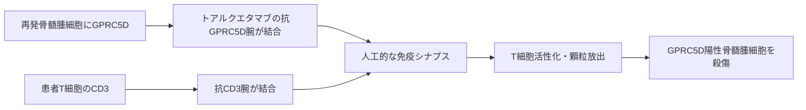

# トアルクエタマブ（Talvey／タービー）

## まず3行で

- 免疫調節薬、プロテアソーム阻害薬、抗CD38抗体などを使っても再発・難治となった多発性骨髄腫に用いる抗体である。
- 骨髄腫細胞のGPRC5DとT細胞のCD3を同時につかみ、患者自身のT細胞を腫瘍へ近接させて殺傷する。
- BCMAとは別の形質細胞抗原を初めて承認薬の標的にした一方、標的が舌・皮膚・爪にもあるため、味覚・口腔・角化組織障害が設計の代償として現れる点が重要である。

## 1. どんな病気か

多発性骨髄腫は、抗体を作る形質細胞が骨髄内でクローン性に増殖する血液がんである。異常免疫グロブリン（M蛋白）の産生、正常造血の圧迫、骨吸収の亢進により、貧血、感染、腎障害、高カルシウム血症、骨痛・骨折を来す。[NCI](https://www.cancer.gov/types/myeloma/patient/myeloma-treatment-pdq)

プロテアソーム阻害薬、免疫調節薬、抗CD38抗体は予後を改善したが、異なるクローンが治療選択を受けて残るため、多くの患者は再発を重ねる。さらにBCMA標的のCAR-Tや二重特異性抗体後には、BCMA低下・消失などの抗原逃避が問題となる。[Leeら](https://pmc.ncbi.nlm.nih.gov/articles/PMC10504087/) そこで「別の表面抗原を住所にする」戦略が必要になった。ただし、どの患者がGPRC5D依存的に反応するかを決める検査は確立していない。

## 2. なぜこの分子を標的にするのか

GPRC5Dは7回膜貫通型のオーファンG蛋白質共役受容体で、内因性リガンド、生理機能、骨髄腫で高発現する理由は未解明である。重要なのは、病気を駆動する必須分子というより、骨髄腫細胞表面に高密度で残りやすい「細胞傷害の住所」であることだ。多治療歴例の検体でも発現し、GPRC5D量が高いほどトアルクエタマブによるex vivo殺傷が強かった。[Verkleijら](https://pmc.ncbi.nlm.nih.gov/articles/PMC8095149/)

発現は正常形質細胞にもあるが、骨髄外の正常組織では主に毛包、汗腺、爪、舌の糸状乳頭など硬ケラチン産生組織に偏る。この分布は重要臓器を広く傷害しにくい長所である一方、味覚異常、口内乾燥、体重減少、皮膚・爪・毛髪障害というオンターゲット・オフ腫瘍毒性を予告する。[EMA評価報告書](https://www.ema.europa.eu/en/documents/assessment-report/talvey-epar-public-assessment-report_en.pdf)

## 3. どんな抗体として設計されたか

### 開発企業

Genmabは自然なIgG4 Fab-arm交換を製造技術にしたDuoBody基盤を提供した。Janssen（現Johnson & Johnson）はGPRC5D×CD3の組合せを創製し、前臨床・臨床開発と商業化を担った。[Genmab](https://www.sec.gov/Archives/edgar/data/1434265/000143426526000014/gmab-20251231.htm)

### 基本設計と作用の仕組み

約147 kDaのヒト化IgG4型1+1二重特異性抗体で、抗GPRC5D腕と抗CD3ε腕を1本ずつ持つ。二つの親IgGを別々に作り、制御Fab-arm交換で正しい異種重鎖対へ組み替える。両標的を同時に結ぶと免疫シナプスができ、T細胞は腫瘍のMHC提示や本来の抗原特異性に依存せず、パーフォリン／グランザイムを放出してGPRC5D陽性細胞を殺す。[Pillarisettiら](https://pmc.ncbi.nlm.nih.gov/articles/PMC7146017/)

### 設計上の工夫

IgG4ヒンジのPro置換は半抗体交換を抑え、下部ヒンジの二つのAla置換（PAA）はFcγ受容体結合を弱める。これによりFcを介した無秩序なT細胞活性化ではなく、GPRC5D依存的な架橋へ寄せる。CH3界面の相補的置換は異種重鎖形成を安定化する。完全長Fcは抗体様の体内滞留を与え、皮下投与、前投薬、漸増投与は初期のサイトカイン放出を抑える治療設計である。[PMDA審査報告書](https://www.pmda.go.jp/drugs/2025/P20250715001/800155000_30700AMX00098_A100_2.pdf)

## 4. 病態から作用まで

## 5. 何が画期的だったのか

2023年に米国で迅速承認され、GPRC5Dを標的とする初の承認薬となった。BCMA治療後にも使える別抗原ルートを、患者別製造を要しない在庫可能な皮下注射で実現した。承認根拠の単群試験では約73%が奏効したが、無作為比較ではなく、長期的な優位性は別途検証が必要である。[FDA](https://www.fda.gov/drugs/cancer-approvals/fda-grants-accelerated-approval-talquetamab-tgvs-relapsed-or-refractory-multiple-myeloma)

> **一言で評価：** この抗体の革新性は、機能未解明でも腫瘍選択的に提示されるGPRC5Dを「住所」として使い、BCMAとは独立した既製品型T細胞リダイレクトを成立させたことにある。

## 6. 実際の医療での位置づけ

2026年11月19日時点の日本では、免疫調節薬、プロテアソーム阻害薬、抗CD38抗体を含む少なくとも3つの標準治療が無効または再発した成人に用いる。0.4 mg/kg週1回または0.8 mg/kg 2週ごとの皮下注で、いずれも漸増する。髄外性形質細胞腫を有する所定の患者では、BCMA×CD3抗体テクリスタマブとの併用も可能である。[PMDA電子添文](https://www.pmda.go.jp/PmdaSearch/iyakuDetail/ResultDataSetPDF/800155_4291480A1024_1_02)

主要な注意はCRS、ICANSなどの神経毒性、感染・血球減少で、開始時は前投薬と入院管理を要する。加えて味覚・口腔、皮膚、爪の障害はGPRC5D分布に直結し、食事量・体重や生活の質を損ねて休薬・減量の原因になり得る。腫瘍側ではGPRC5Dの遺伝的欠失、変異、エピジェネティックなサイレンシングによる抗原逃避が確認されている。[Leeら](https://pmc.ncbi.nlm.nih.gov/articles/PMC10504087/)

## 7. 類薬との違い

| 項目 | トアルクエタマブ | テクリスタマブ | ダラツムマブ |
|---|---|---|---|
| 標的 | GPRC5D×CD3 | BCMA×CD3 | CD38 |
| 抗体形式 | IgG4 1+1 DuoBody | IgG4 1+1 DuoBody | 通常型IgG1 |
| 主作用 | T細胞リダイレクト | T細胞リダイレクト | ADCC・CDC・ADCP等 |
| 強み | BCMA治療後の別抗原経路 | 形質細胞系列に偏るBCMA | 広い治療ラインと併用経験 |
| 特徴的な弱点 | 味覚・口腔、皮膚・爪障害 | 低γグロブリン血症・感染 | 輸血検査干渉、感染等 |

最重要の違いは、殺傷方式だけでなく正常組織での標的分布で毒性が決まることである。トアルクエタマブはBCMAを迂回できるが、硬ケラチン組織への作用を受け入れる必要がある。

## 8. この抗体から学べること

- **疾患生物学：** 再発骨髄腫ではクローンと抗原が変化し、一つの標的だけでは逃避を防げない。
- **標的選択：** 病態ドライバーでなくても、安定した細胞表面発現は細胞傷害の住所になり得る。
- **抗体設計：** DuoBody、Fcサイレンシング、皮下・漸増投与を組み合わせて抗原依存的なT細胞架橋を制御する。
- **残る課題：** 角化組織毒性の予防、反応予測、感染管理、T細胞疲弊とGPRC5D抗原逃避への対策。
- **次に読む抗体：** BCMA×CD3二重特異性抗体テクリスタマブ、抗CD38通常抗体ダラツムマブ。

## 参考文献

1. タービー皮下注3 mg／40 mg 電子添文（第2版）. 医薬品医療機器総合機構, 2026. [PMDA](https://www.pmda.go.jp/PmdaSearch/iyakuDetail/ResultDataSetPDF/800155_4291480A1024_1_02)（2026年11月19日アクセス）
2. タービー皮下注3 mg／40 mg 審査報告書. 医薬品医療機器総合機構, 2025. [PMDA](https://www.pmda.go.jp/drugs/2025/P20250715001/800155000_30700AMX00098_A100_2.pdf)（2026年11月19日アクセス）
3. Talvey: EPAR Public Assessment Report. European Medicines Agency, 2023. [EMA](https://www.ema.europa.eu/en/documents/assessment-report/talvey-epar-public-assessment-report_en.pdf)（2026年11月19日アクセス）
4. FDA grants accelerated approval to talquetamab-tgvs for relapsed or refractory multiple myeloma. U.S. Food and Drug Administration, 2023. [FDA](https://www.fda.gov/drugs/cancer-approvals/fda-grants-accelerated-approval-talquetamab-tgvs-relapsed-or-refractory-multiple-myeloma)（2026年11月19日アクセス）
5. Plasma Cell Neoplasms (Including Multiple Myeloma) Treatment (PDQ®). National Cancer Institute. [NCI](https://www.cancer.gov/types/myeloma/patient/myeloma-treatment-pdq)（2026年11月19日アクセス）
6. Pillarisetti K, et al. A T-cell-redirecting bispecific G-protein-coupled receptor class 5 member D × CD3 antibody to treat multiple myeloma. *Blood*. 2020;135:1232–1243. [PMC](https://pmc.ncbi.nlm.nih.gov/articles/PMC7146017/)
7. Verkleij CPM, et al. Preclinical activity and determinants of response of the GPRC5D×CD3 bispecific antibody talquetamab in multiple myeloma. *Blood Adv*. 2021;5:2196–2215. [PMC](https://pmc.ncbi.nlm.nih.gov/articles/PMC8095149/)
8. Chari A, et al. Talquetamab, a T-cell-redirecting GPRC5D bispecific antibody for multiple myeloma. *N Engl J Med*. 2022;387:2232–2244. [PubMed](https://pubmed.ncbi.nlm.nih.gov/36507686/)
9. Lee H, et al. Mechanisms of antigen escape from BCMA- or GPRC5D-targeted immunotherapies in multiple myeloma. *Nat Med*. 2023;29:2295–2306. [PMC](https://pmc.ncbi.nlm.nih.gov/articles/PMC10504087/)
10. Genmab Annual Report 2025: J&J DuoBody Collaboration. Genmab, 2026. [SEC](https://www.sec.gov/Archives/edgar/data/1434265/000143426526000014/gmab-20251231.htm)（2026年11月19日アクセス）
