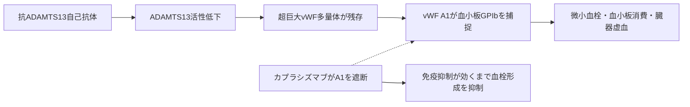

# カプラシズマブ（Cablivi／カブリビ）

## まず3行で

- 自己抗体によってADAMTS13活性が著しく低下する、免疫介在性血栓性血小板減少性紫斑病（iTTP）の急性期に用いる抗体断片である。
- von Willebrand因子（vWF）のA1ドメインをふさぎ、血小板GPIbとの結合を即時に止めて、微小血栓の形成と血小板消費を抑える。
- 承認薬として初めて二価VHH（ナノボディ）を実用化し、免疫抑制が効くまで臓器を守る「即効性の橋渡し」を加えた点が重要である。

## 1. どんな病気か

iTTPは、vWF切断酵素ADAMTS13に対する自己抗体で酵素活性が通常10%未満まで低下する、生命を脅かす血栓性微小血管症である。正常では、血管内皮から放出された超巨大vWF多量体をADAMTS13が切り、過剰な血小板捕捉を防ぐ。iTTPではこの制御が失われ、特に高いずり応力のかかる細動脈・毛細血管で血小板に富む微小血栓ができる。[Furlanら](https://pubmed.ncbi.nlm.nih.gov/9828245/)

その結果、血小板減少と紫斑、赤血球が血栓部で砕ける微小血管症性溶血性貧血、脳・心臓・腎臓などの虚血を来す。血漿交換は自己抗体と有害なvWFを除きADAMTS13を補い、ステロイドや抗CD20抗体リツキシマブは自己免疫を抑える。しかし免疫制御には時間がかかり、その間も微小血栓が進むことが残された課題だった。自己抗体が生じる契機や再発を予測する仕組みには未解明な部分がある。

## 2. なぜこの分子を標的にするのか

vWFは血管内皮細胞と巨核球が作る多量体糖蛋白で、血管損傷部のコラーゲンに結合し、A1ドメインで血小板表面のGPIb-IX-Vを捕捉する。これは高ずり応力下の止血に不可欠だが、ADAMTS13欠乏下では同じ仕組みが病的な血小板凝集を駆動する。

A1を遮断すれば、上流の自己抗体量にかかわらず血栓形成の最終段階を迅速に止められる。一方、ADAMTS13活性を回復させず、既存血栓も直接溶かさないため、血漿交換・免疫抑制の代わりにはならない。また正常止血のvWFも一時的に抑えるので、鼻出血、歯肉出血から重篤な出血までがオンターゲット毒性となる。[FDA品質審査](https://www.accessdata.fda.gov/drugsatfda_docs/nda/2019/761112Orig1s000ChemR.pdf)

## 3. どんな抗体として設計されたか

### 開発企業

AblynxがVHH創薬基盤からALX-0081／ALX-0681を創製し、2007年から臨床開発した。Sanofiは2018年にAblynxを買収し、承認取得後の開発・商業化を担っている。[PMDA審査報告書](https://www.pmda.go.jp/drugs/2022/P20221011001/780069000_30400AMX00437_A100_1.pdf)、[Sanofi](https://www.sec.gov/Archives/edgar/data/1617582/000119312518023017/d515784dex991.htm)

### 基本設計と作用の仕組み

ラマ科動物の重鎖抗体可変領域に由来するヒト化VHHを2個、3残基のアラニンリンカーで直列につないだ一本鎖二価抗体である。259アミノ酸、約27.9 kDaで、軽鎖もFcも持たず、大腸菌で製造する。二つの同一VHHが多量体vWFへ高い結合力を与え、A1と血小板GPIbの相互作用を阻害する。[FDA品質審査](https://www.accessdata.fda.gov/drugsatfda_docs/nda/2019/761112Orig1s000ChemR.pdf) 結晶構造からは、単純な立体競合よりA1の構造を血小板接着に不向きな状態へ固定する可能性が示されているが、これは構造に基づく機序仮説である。[Leeら](https://pubmed.ncbi.nlm.nih.gov/34144500/)

### 設計上の工夫

小さく安定なVHHは、通常IgGの抗原結合部だけを凝縮した形式である。二価化により単一VHHより結合を持続させる一方、不要なADCC・補体活性化を起こすFcを省いた。FcRnによる長時間の再利用を持たず、vWF量に依存する標的介在性消失も受けるため、初回静注後は1日1回皮下注する。小型化は便利さだけでなく、作用の速さと短い制御可能な曝露を選んだ設計でもある。

## 4. 病態から作用まで

## 5. 何が画期的だったのか

2018年の欧州承認は世界初のナノボディ医薬品の実用化となった。[EMA](https://www.ema.europa.eu/en/documents/assessment-report/cablivi-epar-public-assessment-report_en.pdf)、[Leeら](https://pubmed.ncbi.nlm.nih.gov/34144500/) 第3相HERCULES試験では標準療法への追加により血小板数回復を早め、投与期間中のiTTP関連死、再発、主要血栓塞栓イベントの複合リスクを減らした。ただし、ADAMTS13低値のまま中止すると再燃し得ることは、この薬が病因治療ではなく下流遮断薬であることを示す。[Scullyら](https://pubmed.ncbi.nlm.nih.gov/30625070/)

> **一言で評価：** この抗体の革新性は、二価VHHで病的なvWF―血小板接着を即時かつ可逆的に遮断し、自己免疫の制御まで患者を守る新しい治療時間軸を作ったことにある。

## 6. 実際の医療での位置づけ

2026年11月21日時点の日本では、成人および12歳以上かつ体重40 kg以上の小児の後天性TTPに、血漿交換と適切な免疫抑制薬を併用して使う。初日は血漿交換前に10 mgを静注し、終了後に10 mgを皮下注する。以後は血漿交換後に毎日、交換終了後も30日間毎日皮下注し、ADAMTS13低値などが残れば最長おおむね4週間延長できる。[PMDA電子添文](https://www.pmda.go.jp/PmdaSearch/iyakuDetail/ResultDataSetPDF/780069_3399415D1027_1_03)

治療開始を遅らせない利点が大きい一方、確定診断に必要なADAMTS13検査、毎日投与、出血監視が必要である。活動性の重大な出血には使わず、待機手術前には休薬する。抗血小板薬・抗凝固薬併用では特に慎重を要する。血小板数が戻っても自己免疫が残るため、ADAMTS13活性を追いながら免疫抑制を最適化する。

## 7. 類薬との違い

| 項目 | カプラシズマブ | リツキシマブ |
|---|---|---|
| 標的 | vWF A1ドメイン | CD20陽性B細胞 |
| 抗体形式 | 二価VHH、Fcなし | キメラIgG1 |
| 主作用 | vWF―血小板結合を即時遮断 | B細胞除去で自己抗体産生を抑制 |
| 治療上の役割 | 急性期の微小血栓を防ぐ橋渡し | 病因となる免疫反応の制御・再発抑制 |
| 主な弱点 | 出血、毎日投与、免疫病因は残る | 効果発現まで時間、感染・低IgG血症 |

最重要の違いは時間軸である。カプラシズマブは数時間単位で下流を止め、リツキシマブなどは日〜週単位で上流の自己免疫を抑えるため、競合薬ではなく相補的な治療である。[ISTH指針](https://pmc.ncbi.nlm.nih.gov/articles/PMC8091490/)

## 8. この抗体から学べること

- **疾患生物学：** 一つの自己抗体が酵素欠乏を介し、正常な止血分子を微小血栓の駆動因子へ変える。
- **標的選択：** 病因そのものだけでなく、臓器障害へ至る下流の律速点を止める価値がある。
- **抗体設計：** VHHの小型性、二価化、Fc非搭載を組み合わせ、迅速で可逆的な接着阻害に最適化できる。
- **残る課題：** 出血リスク、迅速なADAMTS13検査へのアクセス、投与終了時期、再発予測と免疫寛容の回復。
- **次に読む抗体：** 自己抗体産生B細胞を除去するリツキシマブ、Fc断片で病原性IgGを減らすエフガルチギモド アルファ。

## 参考文献

1. カブリビ注射用10 mg 電子添文. 医薬品医療機器総合機構, 2025. [PMDA](https://www.pmda.go.jp/PmdaSearch/iyakuDetail/ResultDataSetPDF/780069_3399415D1027_1_03)（2026年11月21日アクセス）
2. カブリビ注射用10 mg 審査報告書. 医薬品医療機器総合機構, 2022. [PMDA](https://www.pmda.go.jp/drugs/2022/P20221011001/780069000_30400AMX00437_A100_1.pdf)（2026年11月21日アクセス）
3. Cablivi: EPAR Public Assessment Report. European Medicines Agency, 2018. [EMA](https://www.ema.europa.eu/en/documents/assessment-report/cablivi-epar-public-assessment-report_en.pdf)（2026年11月21日アクセス）
4. Lee HT, et al. High-resolution structure of the vWF A1 domain in complex with caplacizumab, the first nanobody-based medicine for treating acquired TTP. *Biochem Biophys Res Commun*. 2021;567:49–55. [PubMed](https://pubmed.ncbi.nlm.nih.gov/34144500/)
5. Product Quality Review: Caplacizumab. U.S. Food and Drug Administration, 2018. [FDA](https://www.accessdata.fda.gov/drugsatfda_docs/nda/2019/761112Orig1s000ChemR.pdf)（2026年11月21日アクセス）
6. Furlan M, et al. von Willebrand factor-cleaving protease in thrombotic thrombocytopenic purpura and the hemolytic-uremic syndrome. *N Engl J Med*. 1998;339:1578–1584. [PubMed](https://pubmed.ncbi.nlm.nih.gov/9828245/)
7. Ulrichts H, et al. Antithrombotic drug candidate ALX-0081 shows superior preclinical efficacy and safety compared with currently marketed antiplatelet drugs. *Blood*. 2011;118:757–765. [PubMed](https://pubmed.ncbi.nlm.nih.gov/21576702/)
8. Scully M, et al. Caplacizumab treatment for acquired thrombotic thrombocytopenic purpura. *N Engl J Med*. 2019;380:335–346. [PubMed](https://pubmed.ncbi.nlm.nih.gov/30625070/)
9. Zheng XL, et al. ISTH guidelines for treatment of thrombotic thrombocytopenic purpura. *J Thromb Haemost*. 2020;18:2496–2502. [PMC](https://pmc.ncbi.nlm.nih.gov/articles/PMC8091490/)
10. Sanofi to acquire Ablynx for €3.9 billion. Sanofi, 2018. [SEC](https://www.sec.gov/Archives/edgar/data/1617582/000119312518023017/d515784dex991.htm)（2026年11月21日アクセス）
