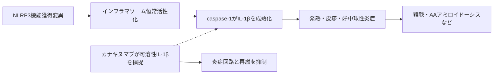

# カナキヌマブ（Ilaris／イラリス）

## まず3行で

- NLRP3インフラマソームが過剰に働くクリオピリン関連周期性症候群（CAPS）をはじめ、IL-1βが駆動する自己炎症性疾患に用いる抗体である。
- 可溶性IL-1βだけを高親和性で捕捉し、IL-1受容体への結合を阻んで、発熱・皮疹・関節症状と持続炎症を抑える。
- 遺伝子異常からサイトカイン、症状までの因果鎖を標的治療として実証し、半減期の長いIgGによりCAPSでは原則8週ごとの投与を可能にした。

## 1. どんな病気か

CAPSは、家族性寒冷自己炎症症候群、マックル・ウェルズ症候群、新生児期発症多臓器系炎症性疾患（NOMID/CINCA）からなる重症度の連続体である。乳幼児期から反復する発熱、蕁麻疹様皮疹、結膜炎、関節痛を呈し、重症例では無菌性髄膜炎、骨病変、進行性感音難聴、持続する血清アミロイドA高値に伴うAAアミロイドーシスを来す。

多くは自然免疫センサーNLRP3の機能獲得変異が原因である。正常では感染・組織障害を感知した時だけNLRP3インフラマソームが組み立ち、caspase-1が前駆体IL-1βを活性型へ切断する。CAPSではこの制御が緩み、単球・マクロファージからIL-1βが過剰に放出される。[Agostiniら](https://pubmed.ncbi.nlm.nih.gov/15030775/) 抗炎症薬やステロイドでは慢性炎症と臓器障害を十分防げなかった。一方、病的変異が通常検査で見つからない例や体細胞モザイクもあり、遺伝子型だけでは重症度・反応を完全には説明できない。

## 2. なぜこの分子を標的にするのか

IL-1βはIL-1受容体I型と共受容体IL-1RAcPを介してNF-κBなどを活性化し、発熱、血管内皮活性化、好中球動員、急性期蛋白産生を引き起こす。局所防御には有用だが、CAPSでは同じ回路が刺激なしに回り続ける。患者のIL-1β産生量は健常者より高く、カナキヌマブ投与後に正常域へ近づいたことから、IL-1β自身が産生を増幅する正のフィードバックも示唆された。[Lachmannら](https://pubmed.ncbi.nlm.nih.gov/19364880/)

可溶性サイトカインを捕捉すれば、NLRP3を持つ正常細胞を除去せず、下流の共通出力を遮断できる。しかもIL-1αや内因性阻害因子IL-1Raを温存する。ただしIL-1βは感染防御にも関わるため、重篤な感染症が主要なオンターゲットリスクとなる。既に固定した難聴や骨・中枢神経障害が完全に戻るとは限らず、IL-18など他のインフラマソーム産物は直接抑えない。

## 3. どんな抗体として設計されたか

### 開発企業

NovartisがMedarexのUltiMAbヒト抗体作製技術を用いてACZ885を創製し、非臨床・臨床開発と承認取得を担った。ヒトIL-1βを免疫したHuMabマウスのB細胞から得た抗体である。[EMA審査報告書](https://www.ema.europa.eu/en/documents/assessment-report/ilaris-epar-public-assessment-report_en.pdf)、[Medarex](https://www.sec.gov/Archives/edgar/data/874255/000104746908001844/a2182806z10-k.htm)

### 基本設計と作用の仕組み

約148 kDaの完全ヒトIgG1κ通常抗体で、マウス骨髄腫Sp2/0細胞で産生する。IL-1βの広く平坦な不連続エピトープへ約40 pMで結合し、その一部は受容体結合面と重なる。これによりIL-1β―IL-1受容体結合を立体的に妨げるが、IL-1α、IL-1Ra、他のIL-1ファミリーには交差反応しない。[Rondeauら](https://pmc.ncbi.nlm.nih.gov/articles/PMC4966334/)

### 設計上の工夫

標的は細胞表面でなく可溶性サイトカインなので、通常のIgG1 Fcを持っていても抗原依存的ADCC・CDCは期待されず、目的は中和とFcRnによる長い曝露である。平均終末半減期は約26日で、CAPSでは体重40 kg超なら通常150 mgを8週ごとに皮下注する。これは毎日注射する短半減期の受容体拮抗薬に対し、持続性を抗体形式で解いた設計である。

## 4. 病態から作用まで

## 5. 何が画期的だったのか

NLRP3変異の発見から、異常インフラマソーム、IL-1β過剰、臨床症状という分子経路が短期間でつながり、2009年にIL-1β選択的完全ヒト抗体が承認された。CAPSの第III相試験では初回投与を受けた35例中34例が完全奏効し、無作為化中止期には継続群全例が寛解を保った一方、プラセボ群では13/16例が再燃した。[Lachmannら](https://doi.org/10.1056/NEJMoa0810787) 小集団の希少疾患でも、強い病因仮説と投与中止デザインで標的妥当性を示した好例である。

> **一言で評価：** この抗体の革新性は、単一遺伝子性の自然免疫異常をIL-1β選択的かつ長時間の中和へ翻訳し、症候群を機序に基づいて治療できる病気へ変えたことにある。

## 6. 実際の医療での位置づけ

2026年11月24日時点の日本ではCAPSに加え、HIDS/MKD、TRAPS、家族性地中海熱、全身型若年性特発性関節炎、成人発症スチル病、2026年2月追加のシュニッツラー症候群に承認されている。CAPSでは体重別に原則8週ごと、反応不十分なら増量・間隔短縮を検討する。[PMDA電子添文](https://www.pmda.go.jp/PmdaSearch/iyakuDetail/ResultDataSetPDF/300242_3999434A1026_1_08)

発作だけでなく無症候期の炎症を抑え、臓器障害を予防する継続治療として位置づく。重篤な感染症、結核再活性化、好中球減少に注意し、生ワクチンを避ける。長い投与間隔は負担を減らす反面、感染時に作用をすぐ解除できず、薬価と専門施設での継続管理も制約となる。

## 7. 類薬との違い

| 項目 | カナキヌマブ | アナキンラ | リロナセプト |
|---|---|---|---|
| 標的 | IL-1β | IL-1受容体I型 | IL-1α/βを捕捉 |
| 形式 | 完全ヒトIgG1κ | 組換えIL-1Ra | IL-1受容体-Fc融合蛋白 |
| CAPSでの投与 | 原則8週ごと皮下注 | 毎日皮下注 | 週1回皮下注 |
| 強み | IL-1β選択性、長い間隔 | 短時間で用量調節しやすい | 両IL-1を長時間捕捉 |
| 主な弱点 | 長期曝露、感染、費用 | 毎日投与、注射部位反応 | IL-1αも遮断、週1回投与 |

最重要の違いは、同じIL-1経路でも「リガンド選択性」と「作用を戻せる速さ」が異なる点である。重症NOMIDで細かな調節を要する場合にはアナキンラの短時間作用が利点になり得る一方、カナキヌマブは長期管理の投与負担を小さくする。[FDA Kineret添付文書](https://www.accessdata.fda.gov/drugsatfda_docs/label/2025/103950s5197lbl.pdf)、[FDA Arcalyst添付文書](https://www.accessdata.fda.gov/drugsatfda_docs/label/2026/125249Orig1s057lbl.pdf)

## 8. この抗体から学べること

- **疾患生物学：** 自己抗体がなくても、自然免疫センサーの恒常活性化だけで全身炎症が起こる。
- **標的選択：** 遺伝子異常そのものを直せなくても、疾患を駆動する共通の分泌因子を遮断できる。
- **抗体設計：** 可溶性サイトカインでは細胞傷害性より選択性と半減期が設計価値になる。
- **残る課題：** 不可逆的臓器障害、遺伝子陰性例、感染リスク、長期中止条件と個別用量の最適化。
- **次に読む抗体：** 上皮由来サイトカインを上流で中和するテゼペルマブ、受容体を遮断するトシリズマブ。

## 参考文献

1. イラリス皮下注射液150 mg 電子添文. 医薬品医療機器総合機構, 2026. [PMDA](https://www.pmda.go.jp/PmdaSearch/iyakuDetail/ResultDataSetPDF/300242_3999434A1026_1_08)（2026年11月24日アクセス）
2. Ilaris: EPAR Public Assessment Report. European Medicines Agency, 2009. [EMA](https://www.ema.europa.eu/en/documents/assessment-report/ilaris-epar-public-assessment-report_en.pdf)（2026年11月24日アクセス）
3. ILARIS (canakinumab) Prescribing Information. U.S. Food and Drug Administration, 2024. [FDA](https://www.accessdata.fda.gov/drugsatfda_docs/label/2024/125319s110lbl.pdf)（2026年11月24日アクセス）
4. Hoffman HM, et al. Mutation of a new gene encoding a putative pyrin-like protein causes familial cold autoinflammatory syndrome and Muckle-Wells syndrome. *Nat Genet*. 2001;29:301–305. [PMC](https://pmc.ncbi.nlm.nih.gov/articles/PMC4322000/)
5. Agostini L, et al. NALP3 forms an IL-1β-processing inflammasome with increased activity in Muckle-Wells autoinflammatory disorder. *Immunity*. 2004;20:319–325. [PubMed](https://pubmed.ncbi.nlm.nih.gov/15030775/)
6. Lachmann HJ, et al. In vivo regulation of interleukin 1β in patients with cryopyrin-associated periodic syndromes. *J Exp Med*. 2009;206:1029–1036. [PubMed](https://pubmed.ncbi.nlm.nih.gov/19364880/)
7. Lachmann HJ, et al. Use of canakinumab in the cryopyrin-associated periodic syndrome. *N Engl J Med*. 2009;360:2416–2425. [DOI](https://doi.org/10.1056/NEJMoa0810787)
8. Rondeau JM, et al. The molecular mode of action and species specificity of canakinumab, a human monoclonal antibody neutralizing IL-1β. *mAbs*. 2015;7:1151–1160. [PMC](https://pmc.ncbi.nlm.nih.gov/articles/PMC4966334/)
9. Romano M, et al. The 2021 EULAR/ACR points to consider for diagnosis, management and monitoring of IL-1 mediated autoinflammatory diseases. *Ann Rheum Dis*. 2022;81:907–921. [PMC](https://pmc.ncbi.nlm.nih.gov/articles/PMC9531906/)
10. Annual Report on Form 10-K. Medarex, 2008. [SEC](https://www.sec.gov/Archives/edgar/data/874255/000104746908001844/a2182806z10-k.htm)（2026年11月24日アクセス）
