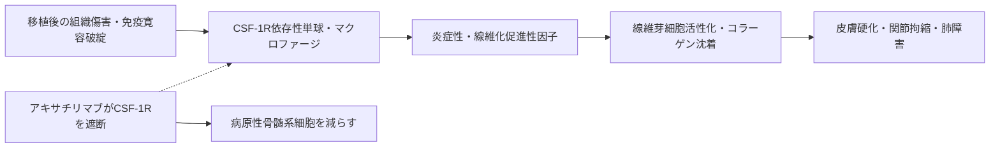

# アキサチリマブ（Niktimvo）

## まず3行で

- 同種造血細胞移植後にドナー免疫が患者の組織を慢性的に傷つける、慢性移植片対宿主病（慢性GVHD）に用いる抗体である。
- 単球・マクロファージの生存を支えるCSF-1受容体（CSF-1R）を遮断し、炎症性・線維化促進性の骨髄系細胞を減らす。
- T細胞・B細胞中心だった慢性GVHD治療に、組織線維化をつなぐマクロファージという新しい治療軸を臨床導入した点が重要である。

## 1. どんな病気か

慢性GVHDは、白血病などに対する同種造血細胞移植後、ドナー由来免疫細胞が患者の組織を異物と認識して起こす多臓器疾患である。皮疹、口腔潰瘍、眼・口の乾燥、肝障害に加え、皮膚・筋膜・関節の硬化や肺の閉塞性障害を来し、生活機能と長期生存を損なう。[NIH GARD](https://rarediseases.info.nih.gov/diseases/10964/chronic-graft-versus-host-disease/)

病態は単なる「ドナーT細胞の攻撃」ではない。移植前処置と初期炎症による組織傷害、T細胞・B細胞の免疫寛容破綻、異常な修復反応が連鎖し、後期にはマクロファージと線維芽細胞がTGF-βなどを介してコラーゲン沈着を進める。[NIHコンセンサス報告](https://pmc.ncbi.nlm.nih.gov/articles/PMC6020045/) ステロイドは標準的初期治療だが、長期毒性、感染、抵抗例と不可逆的線維化が課題である。どの患者・臓器がマクロファージ依存性か、形成済みの線維化をどこまで戻せるかは未解明である。

## 2. なぜこの分子を標的にするのか

CSF-1R（CD115）は単球・マクロファージ系に多い受容体型チロシンキナーゼで、CSF-1またはIL-34が結合すると、その生存、分化、増殖、組織内機能を支える。マウス慢性GVHDでは、ドナー骨髄由来のCSF-1R陽性マクロファージが皮膚と肺へ浸潤し、抗CSF-1R抗体による除去で病変が軽減した。[Alexanderら](https://www.jci.org/articles/view/75935)

受容体を狙えば、二つのリガンドを一度に遮断し、リンパ球を広く抑えるのではなく、炎症と異常修復をつなぐ骨髄系細胞へ介入できる。一方、正常マクロファージは感染防御、骨代謝、組織恒常性にも必要である。感染と骨成長への影響はオンターゲット毒性として生物学的に説明できる。肝・筋・膵酵素上昇も用量依存性を示すが、機序は確立していない。

## 3. どんな抗体として設計されたか

### 開発企業

UCBがUCB6352として創製し、Syndax Pharmaceuticalsが2016年に全世界の権利を導入してSNDX-6352として開発した。Incyteは2021年にSyndaxと共同開発・共同商業化契約を結び、米国では共同販売、米国外ではIncyteが商業化を主導する。[Incyte](https://investor.incyte.com/news-releases/news-release-details/incyte-reports-2025-first-quarter-financial-results-and-provides)

### 基本設計と作用の仕組み

約150 kDaのヒト化IgG4κ通常抗体で、CHO細胞で製造する。CSF-1Rへ高親和性で結合し、CSF-1とIL-34による受容体活性化を遮断する。FDA審査資料では、受容体を作動させず、細胞表面CSF-1Rの内在化も誘導しなかった。したがって主作用はFcによる無差別な細胞傷害ではなく、生存シグナルの遮断による非古典的単球の減少と、組織病原性マクロファージの機能抑制である。[FDA審査報告書](https://www.accessdata.fda.gov/drugsatfda_docs/nda/2024/761411Orig1s000MultidisciplineR.pdf)

### 設計上の工夫

IgG4はIgG1よりFcエフェクター活性が低く、受容体遮断を中心とする設計に適する。さらにヒンジのS228P置換でFab-arm exchangeを抑え、二価抗体を安定化している。[USAN](https://searchlf.ama-assn.org/usan/documentDownload?uri=%2Funstructured%2Fbinary%2Fusan%2Faxatilimab-.pdf) 承認用量は0.3 mg/kg（最大35 mg）を2週ごとに30分かけて静注する。高用量ほど有効性が上がらず酵素上昇が増えたことは、標的介在性薬物動態とマクロファージ恒常性の間に治療域を置く必要を示す。

## 4. 病態から作用まで

## 5. 何が画期的だったのか

FDA審査時点で承認済みCSF-1R阻害薬はなく、2024年の承認は、動物モデルで見つかった「CSF-1R依存性マクロファージが線維化を駆動する」という仮説を治療へ翻訳した。第II相AGAVE-201では承認用量群の74%が最初の6サイクル内に多臓器基準で奏効した。先行する第I/II相試験では皮膚生検のCSF-1R陽性マクロファージ減少も確認された。ただし反応率は盲検対照試験との直接比較ではなく、長期的に不可逆線維化を変えるかは今後の課題である。[Wolffら](https://pubmed.ncbi.nlm.nih.gov/39292927/)、[Kitkoら](https://pubmed.ncbi.nlm.nih.gov/36459673/)

> **一言で評価：** この抗体の革新性は、慢性GVHDの免疫異常と線維化をつなぐCSF-1R依存性マクロファージを、臨床的に成立する標的へ変えたことにある。

## 6. 実際の医療での位置づけ

2026年11月27日時点の米国では、2ライン以上の全身治療が無効だった成人・体重40 kg以上の小児慢性GVHDに承認され、2025年から販売されている。2026年には豪州でも6歳以上かつ40 kg以上を対象に承認された。[DailyMed](https://dailymed.nlm.nih.gov/dailymed/drugInfo.cfm?setid=bb6dba23-e7a6-4765-a1e6-b9e277ce0381)、[TGA](https://www.tga.gov.au/resources/prescription-medicines-registrations/niktimvo-specialised-therapeutics-alim-pty-ltd)

多くはステロイドや他の免疫抑制薬を継続しながら追加する後治療である。承認用量群では感染、AST・ALT上昇、低リン血症、貧血、筋骨格痛、膵酵素上昇などが多く、輸注反応は18%にみられた。定期静注と検査が必要で、正常マクロファージ機能と成長期骨への影響、既存の広範な線維化では効果が限られ得ることが制約となる。

## 7. 類薬との違い

| 項目 | アキサチリマブ | ルキソリチニブ | ベルモスジル |
|---|---|---|---|
| 標的 | CSF-1R | JAK1/2 | ROCK2 |
| 形式 | ヒト化IgG4κ抗体 | 低分子阻害薬 | 低分子阻害薬 |
| 主な作用軸 | 単球・マクロファージの生存と線維化 | 多数のサイトカインシグナル | Th17/Treg均衡と線維化 |
| 投与 | 2週ごと静注 | 1日2回経口 | 1日1回経口 |
| 強み | 骨髄系細胞を比較的選択的に狙う | より早い治療ライン、広い抗炎症作用 | 免疫と線維化の両面を調節 |
| 主な弱点 | 静注、酵素上昇、感染・骨への影響 | 血球減少、感染、広いシグナル阻害 | 薬物相互作用、肝障害、経口継続 |

最重要の違いは、アキサチリマブが細胞外受容体を抗体で選択的に遮断し、慢性GVHDの骨髄系・線維化軸へ治療範囲を絞る点である。その代わり、経口薬の利便性はなく、病態の全てを一つの細胞系で説明できないため、患者選択バイオマーカーが必要になる。[FDA Jakafi添付文書](https://www.accessdata.fda.gov/drugsatfda_docs/label/2026/202192s033lbl.pdf)、[FDA Rezurock添付文書](https://www.accessdata.fda.gov/drugsatfda_docs/label/2026/214783s012lbl.pdf)

## 8. この抗体から学べること

- **疾患生物学：** 慢性GVHDはリンパ球の自己免疫様反応だけでなく、マクロファージ依存性の異常修復・線維化を含む。
- **標的選択：** 共有受容体CSF-1Rを狙えば、CSF-1とIL-34の二つの生存入力を同時に遮断できる。
- **抗体設計：** 低エフェクターIgG4とヒンジ安定化を組み合わせ、細胞傷害より受容体拮抗を優先できる。
- **残る課題：** 臓器別反応、長期感染・骨安全性、不可逆線維化、最適な併用・中止条件と予測マーカー。
- **次に読む抗体：** T細胞共刺激を遮断するアバタセプト、CD19陽性B細胞を除去するイネビリズマブ。

## 参考文献

1. NIKTIMVO (axatilimab-csfr) Prescribing Information. Incyte / DailyMed, 2026. [DailyMed](https://dailymed.nlm.nih.gov/dailymed/drugInfo.cfm?setid=bb6dba23-e7a6-4765-a1e6-b9e277ce0381)（2026年11月27日アクセス）
2. BLA Multidisciplinary Review and Evaluation: Niktimvo. U.S. Food and Drug Administration, 2024. [FDA](https://www.accessdata.fda.gov/drugsatfda_docs/nda/2024/761411Orig1s000MultidisciplineR.pdf)（2026年11月27日アクセス）
3. Australian Public Assessment Report for Niktimvo. Therapeutic Goods Administration, 2026. [TGA](https://www.tga.gov.au/sites/default/files/2026-06/auspar-niktimvo-260602.pdf)（2026年11月27日アクセス）
4. Chronic graft versus host disease. Genetic and Rare Diseases Information Center, National Institutes of Health. [GARD](https://rarediseases.info.nih.gov/diseases/10964/chronic-graft-versus-host-disease/)（2026年11月27日アクセス）
5. Cooke KR, et al. The Biology of Chronic Graft-versus-Host Disease: A Task Force Report from the NIH Consensus Development Project. *Biol Blood Marrow Transplant*. 2017;23:211–234. [PubMed](https://pubmed.ncbi.nlm.nih.gov/27713092/)
6. Alexander KA, et al. CSF-1-dependent donor-derived macrophages mediate chronic graft-versus-host disease. *J Clin Invest*. 2014;124:4266–4280. [JCI](https://www.jci.org/articles/view/75935)
7. Kitko CL, et al. Axatilimab for chronic graft-versus-host disease after failure of at least two prior systemic therapies. *J Clin Oncol*. 2023;41:1864–1875. [PubMed](https://pubmed.ncbi.nlm.nih.gov/36459673/)
8. Wolff D, et al. Axatilimab in recurrent or refractory chronic graft-versus-host disease. *N Engl J Med*. 2024;391:1002–1014. [PubMed](https://pubmed.ncbi.nlm.nih.gov/39292927/)
9. Statement on a Nonproprietary Name Adopted by the USAN Council: Axatilimab. American Medical Association, 2025. [USAN](https://searchlf.ama-assn.org/usan/documentDownload?uri=%2Funstructured%2Fbinary%2Fusan%2Faxatilimab-.pdf)（2026年11月27日アクセス）
10. Incyte Reports 2025 First Quarter Financial Results and Provides Updates on Key Clinical Programs. Incyte, 2025. [Incyte](https://investor.incyte.com/news-releases/news-release-details/incyte-reports-2025-first-quarter-financial-results-and-provides)（2026年11月27日アクセス）
